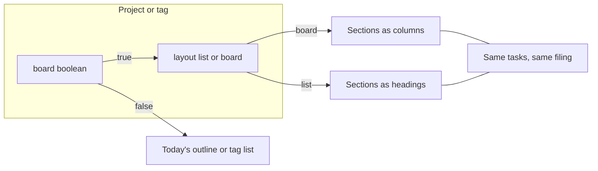
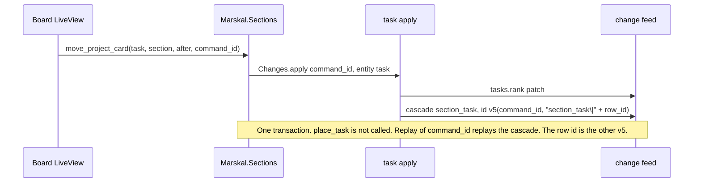

# Opt-in boards for a project or a tag

| | |
|---|---|
| Author | Mikl (drafted with Grok) |
| Date | 2026-11-19 |
| Status | Draft (revised) |
| ADR to follow | 0041 (0040 is the last accepted ADR; 0036 is unused) |

## Overview

A project page and a tag page are lists. A project page is an outline (`MarskalWeb.ProjectLive` renders `MarskalWeb.TaskComponents.list` with `outline`). A tag page is a flat list of the tasks that carry that tag, then one group per child tag (`Marskal.Tags.outline/3`, `MarskalWeb.TagLive`), plus a "Tags inside" outline (`MarskalWeb.NavOutline` in `tag_live.ex`). Nothing in the schema is a section, a column, or a saved layout.

This design adds an opt-in **board** on a single project or a single tag. The user turns it on for that container. The columns, in order, are **To-Do**, the **sections** the user names, and **Done**. To-Do is always shown, first, even when it has no cards. It is the column of open tasks that are not filed in a section: state To-Do, and no section in this container. It has an add field and a drop target, including a minimum height when empty. A filed card can be moved there. That clears the placement and leaves the task To-Do. Named sections sit between those bookends and show only To-Do cards filed there. Done is always on the board, even when empty, and holds every Done card of this container. Completing keeps the placement. There is no column named "No section". List layout uses the same membership. It always shows the To-Do heading, with its add field, including when empty, and omits the Done heading when it is empty. Task state stays To-Do, Done, and Dropped. The bookends are views of those states. A named section is a place in the container, and the board does not add a workflow status.

The web app is the first UI. The rows sync, so a later terminal or iOS board reads the same data. v1 does not draw a board in those clients.

The decisions are collected under **Key Decisions**, immediately before the PR Plan.

## Background & Motivation

Todoist, which this request uses as the reference, lets a project switch between list and board. In the default grouping each section is a column, tasks with no section sit in "(No Section)", and the same sections are headings in the list. A label can be a board too, in which case the columns group tasks that live somewhere else. Marskal has the two containers the request asks for (a project, a tag) and has neither sections nor a layout field. Marskal does not use Todoist's "(No Section)" heading. The left bookend is To-Do. It stays, including when empty, because that column is the open tasks that are not in a section. Done is the right bookend.

The import path already meets Todoist sections and refuses them. The private `Marskal.Imports.TodoistAdapter.task/5` looks up `section_id` in the snapshot's `sections` array, stores the name on the task node under `extras["section"]`, and adds `{:missing_section, "Section", section}`. `Marskal.Imports.Problems.mark/2` then tags the task **Missing section** and appends a notes block. The block is several lines, not one sentence. For the fixture task it is a blank line, then `---`, then `Imported from Todoist:`, then `- Section: Now` (`web/test/marskal/imports/todoist_adapter_test.exs` expects `"Home page\n\n---\nImported from Todoist:\n- Section: Now"`). `Problems` joins `["---", "Imported from #{source_name}:" | lines]` with newlines (`problems.ex`). The fixture in `web/test/support/todoist_snapshot.ex` has a section `s1` named "Now" on project `p1`, and task `t2` points at it. That section has `id`, `name`, `project_id`, and `is_deleted`, and no order field. `web/lib/marskal_web/live/import_live.ex` `preview_note/1` is a raw literal, not yet Gettext: "Already-imported items are updated with what changed in Todoist, except where you changed the same thing here. Items you deleted here come back. Labels become tags. Sections and recurrence cannot be brought over yet; those tasks are tagged Import problems. Completed history is not included." The OmniFocus adapter does not do this. An OmniFocus action group is a parent task (private `parse_task/2` reads `parent_id`); there is no section field and no `missing_section` problem from that adapter. ADR 0013 names the Todoist section as an unmapped field that stays in `extras`.

A board whose only columns were To-Do, Done, and Dropped, or Defer, Planned, and Due, would restate columns the product already refused as statuses and lists (ADR 0008, ADR 0010). The bookends in this design are not that board. They are views of the states a task already has, and the columns the user names are the sections between them. Turning a board on does not create starter sections called To-Do, Doing, and Done. A board made out of child tags would freeze a workflow into the tag tree, which ADR 0005 keeps as labels. The missing piece is a named heading that belongs to one project or one tag and holds that container's tasks.

Personal scale is the load: one user, hundreds to a few thousand tasks. The project page already loads every live task in the project (`Marskal.Tasks.list_project_tasks/3`). A board adds one small section query and one placement query beside that, and groups in memory.

## Goals & Non-Goals

### Goals

- Opt in per project and per tag. The default page of every existing project and tag stays the page it is today.
- The user can add, rename, reorder, and remove sections, and can move tasks between them, with the pointer and with the keyboard (ADR 0031, amended in the same PR as the keys).
- List layout and board layout show the same membership and the same section filing. To-Do is shown in both, including when it has no cards. They differ in one empty state: the Done column is always on the board, and the list omits the Done heading when it has no cards.
- A task in a project and on a tag can be filed in each board separately.
- Rows sync through the change feed (ADR 0014, ADR 0019). Derived fields stay derived.
- The next occurrence of a repeating task or project keeps the filing it was copied from (ADR 0007). `board` and `layout` are explicit attributes of that copy.
- Copy goes through Gettext, whole sentences, in `MarskalWeb` only (ADR 0028).

### Non-Goals

- A board for Inbox, No project, Open tasks, the agenda, Flagged, Review, or a saved search. Inbox stays a location (ADR 0017).
- A new state, or starter sections named To-Do, Doing, and Done. To-Do and Done are bookends over the states ADR 0008 already has. Dropped is shown only when that visibility is on and the column has cards. Waiting, Someday, priority, assignee, and a day are not columns.
- WIP limits, column colors, column automation, and a calendar layout.
- A per-member layout. When folder sharing ships, a project's `layout` stays on the project and applies to every member. Sections stay with the project. Tag boards stay personal. v1 does not build sharing.
- Terminal and iOS drawing a board in v1. They gain the rows when the replica ships, and the screens later.
- Mapping Todoist sections during the first schema PR. That is its own later PR, specified below so the schema can hold it.
- Changing which tasks a tag page lists. Child-tag groups stay on the page. The "Tags inside" outline stays.

## Proposed Design

### What a board is

A project or a tag has `board` (boolean, default false) and `layout` (`list` or `board`, default `list`).

| `board` | `layout` | Page |
|---|---|---|
| false | ignored | Today's page. Placements are not read. |
| true | `board` | Columns. |
| true | `list` | The same tasks and sections, as headings. |

Both project changesets cast the new fields: `Marskal.Projects.Project.create_changeset/4` and `Project.update_changeset/3`. Both tag changesets cast them: `Marskal.Tags.Tag.create_changeset/4` and `Tag.update_changeset/4`. `client_fields/1` on each entity lists `board` and `layout` for insert and for patch. An allow-list entry without a cast drops the field on the way into the database. Tag `rank` stays off `client_fields/1`, as it is today; `board` and `layout` are ordinary client fields, unlike rank.

The inspector gains "Use a board" and, once it is on, "Stop using a board". Both project and tag inspector forms are `phx-change="save"` autosave (`inspector_panel.ex`, ids `inspector-project` and `inspector-tag`). A checkbox inside that form would ride the save handler and would not call `set_board/4`. The control is a `phx-click` button outside that form. Delete is the existing mode-style control: `type="button"`, `phx-click`, `data-confirm`, and it is not a field the autosave payload serializes (it happens to sit inside the `<form>`). The board button sits after `</form>`, beside that actions row, so the save handler never sees it. The click calls `Marskal.Sections.set_board/4`. Turning the board on patches `board` to true and `layout` to `board` in one command. Turning it off patches `board` to false and leaves `layout` stored. Sections and placements stay, so turning it back on restores the filing. Turning a tag's `board` off restores that tag's flat oldest-first list. Placements remain for the next time it is turned on. That is decided. The flash is "This project uses a board." or "This tag uses a board." Stopping uses "This project no longer uses a board." or "This tag no longer uses a board." Sections are not deleted by that patch.

While `board` is true, the page heading (`MarskalWeb.NavComponents.page_heading`, used by `ProjectLive` and `TagLive`) shows two controls, List and Board, which patch `layout`. The icon is Lucide `columns-3`, rendered the way `Lucideicons.inbox` is rendered (`Lucideicons.columns_3`); confirm the generated function name against the `lucide_icons` package at implementation time.



### Sections

A section has a name, an owner, exactly one container, a fractional rank among the sections of that container, and `discarded_at`. A section is an ordinary entity. Discarding one is a real delete, the way deleting a tag is a real delete. It is not a link row.

- Name: one segment, trimmed, NFC in the changeset, maximum 200 characters (the tag name limit in `Marskal.Tags.Tag`). Any character is allowed. Unique per container among live sections, case-insensitive, the same `citext` rule as tag names. `CHECK (name <> '')` rejects empty after trim. Online `Marskal.Sections.create_section/3` and `rename_section/4` hit that unique index and return "is already used here", the same way `Tags.create_tag/3` does. They do not merge.
- Two offline devices creating the same live name under the same container: Push calls `Sections.insert_client_section/3` and `Sections.patch_client_section/4`, not the online functions. The server keeps the first and discards the second with `merged_into_id` set, and rewrites placements onto the first. That is `Tags.insert_client_tag/3` and `Tags.patch_client_tag/4` applied to sections, smaller because a section has no children. `merged_into_id` is server-only. It is in the pull columns. A later command that still names the discarded section is resolved through `merged_into_id` before the write, the way the private `Tags.resolve_tag/2` follows a merged tag. The public section functions call that resolve; Push does not trust the client's id once a merge has happened.
- Rank: `text COLLATE "C"`, validated with `Marskal.Rank.valid?/1` the way the private `Task.validate_rank/1` validates a task rank ("is not a valid rank"). Clients may write it, as they write `tasks.rank`. The server fills the end rank when the command omits it (`Rank.between(last, nil)`).
- Order on screen. To-Do, always, even when it has no cards, then live sections by `rank`, then `id`, then Done. On the board, Done is present even when it has no cards. In the list, the To-Do heading is present even when it has no cards, and the Done heading is omitted when it has no cards. Dropped is last, and only when `:dropped` is in `show` and it has cards. To-Do, Done, and Dropped are not stored sections and have no rank among sections. There is no heading named "No section". The technical name for a card with no live placement is unfiled.
- A section has no state, no dates, and no color.

Removing a section discards it. Tasks are not discarded. There is no confirm dialog. That is decided. Drop already has none (ADR 0031), and this does not destroy tasks. Every placement in that section is cleared, including placements of Done and Dropped cards that were not drawn in the column. To-Do cards from the section are appended to the unfiled group, in their previous relative order. Those cards are then in the To-Do column, which is already on the board. Done cards stay in Done. Their order there is `resolved_at`, so the delete does not append them to the unfiled rank list and does not give them a placement rank. A later reopen of one of those cards finds no section and joins the To-Do column at that moment, appended to the unfiled group. The flash is "Section removed. Its tasks are in To-Do." There is no "Moved to No section." and no "Section removed. Its tasks are in No section." The web button calls `Sections.delete_section/3` directly. A sync client sends a `section` patch whose fields set `discarded_at`. `Marskal.Sync.Push` turns that patch into `delete/4` before any context patch runs (the two clauses above insert and patch dispatch, for every entity except `task_tag` and `project_tag`). `delete/4` then calls `Sections.delete_section/3`, parallel to `delete(user, "tag", id, command_id)` calling `Tags.delete_tag/3`. `patch_client_section/4` is the name and rank path. A discard never arrives there. The rank rewrite differs by container, and both are one transaction of cascades from that delete command:

- **Project.** Each To-Do root that was in the section is appended, in its previous relative order, after the To-Do roots already unfiled. The server patches `tasks.rank` at the end of that unfiled To-Do group (`Outline.rank_last/3` and `Rank.between/2` along the moved list). It cascade-discards every project placement in the section, To-Do, Done, and Dropped. A project placement cannot store a rank and cannot store a null `section_id`, so discarding the row is what makes the task unfiled. The To-Do column's sibling group is unfiled roots whose state is To-Do, so a Done card whose placement was just cleared does not sit in that rank list. Discarding a To-Do placement and leaving `tasks.rank` alone would interleave the old per-column ranks. That interleave is accepted only when the board is turned off (see Risks). Delete does the append for To-Do cards.
- **Tag.** The server writes `section_tasks.rank` for the To-Do cards, not `tasks.rank`. If the unfiled column has no manual ranks yet, it first assigns a rank to every To-Do card already unfiled, in the order they are displayed. It then appends the moved To-Do cards after those, keeping their relative order. Each of those rows is retargeted to `section_id` null, or, when the row is discarded and a new live row would violate the one-row unique, revived in place with `section_id` null and the new rank. Done and Dropped placements in the section are discarded and are not given a null `section_id` rank. Done and Dropped do not gain a rank on the placement. One row per task per tag, including discarded rows, so the write updates that row rather than inserting a second one.

The cap is 50 live sections per container. That number is decided. `create_section` and `insert_client_section` enforce it in the same transaction as the insert: `SELECT … FOR UPDATE` on the project or tag row, then count live sections, then insert. Two concurrent inserts serialize on that row. The second sees 50 and fails. A push of up to `Marskal.Sync.Push.max_commands/0` (1000) commands runs in one process, so the same lock covers a burst of section inserts. The error is a changeset error the LiveView shows as "This board already has as many sections as it can."

### Placements

```text
section_tasks
  id            -- UUIDv5 of the container and the task; not a command id
  user_id
  task_id
  project_id    -- xor with tag_id: the container
  tag_id
  section_id    -- required on a project row; null only for a tag unfiled rank
  rank          -- tag-board order; null on a project placement
  discarded_at  -- ordinary field, as on task_tags
```

The id is the v5 UUID of the container and the task, so two devices filing the same task in the same container name one row.

- Namespace: `a5c0ffee-0041-5000-8000-000000000041`
- Name (UTF-8): `project|{project_id}|{task_id}` or `tag|{tag_id}|{task_id}`
- Ids are canonical lowercase UUIDs, as in `Marskal.Tags.Link.id/3`.

`Marskal.Sections.section_task_id/2` mints it. `core/rules` `ids` grows `section_task_id` in the replica PR and checks the same fixture. The Elixir function and the fixture land in the schema PR, because the server inserts rows before the replica does. Changing the namespace would duplicate rows across devices, which is why the link namespace is fixed in `core/rules/src/ids.rs`.

That row id is not a command id. `Changes.cascade/5` derives its command id as `Marskal.Uuid.v5(command_id, "#{entity_type}|#{entity_id}")`. For a placement that string is `"section_task|" <> row_id`. A replay of the user's command replays the cascade because the cascade runs inside the user's transaction. Calling the two writes as two LiveView steps would commit the first even when the second fails, and a replay of the task command would not replay the placement.

`section_task` is a link row, in the same sense as `task_tag` and `project_tag` (ADR 0014).

- `discarded_at` is an ordinary field. Filing again clears it. The later command wins. `Entity::is_link` returns true for `section_task` once the replica knows the entity. It stays false for `section`.
- `Marskal.Sync.Push` today treats a patch that sets `discarded_at` as `delete/4`, and a patch that clears it strips the field ("There is no revive"), unless the entity is `task_tag` or `project_tag` (`push.ex`, the two clauses before `dispatch` of insert and patch). `section_task` joins that exception list. A discard patch updates the row. A revive patch clears `discarded_at`. Falling through to `delete/4` would hit the catch-all and `stop/3` would halt the rest of the push.
- Link insert rejects an id that is not the v5 of the pair with `invalid_id` (`Push.link/6` compares `Link.id/3` to `command.entity_id`). A `section_task` insert does the same check against `Sections.section_task_id/2`. A second device that invents a different primary key is `invalid_id`, rather than a unique-index failure on `(task_id, project_id)`. Section ids themselves are client-supplied UUIDv7, like task ids. They do not take this check.
- Tests follow `web/test/marskal/sync_push_test.exs`: "a duplicate name merges into the tag already there" and "a link's id must be the one of its pair".

A live row is the task's filing in that one container.

- A project row always has a non-null `section_id` and a null `rank`. Unfiled on a project is the absence of a live row. A live project row with a null `section_id` is rejected by `CHECK (project_id IS NULL OR section_id IS NOT NULL)`. Showing the empty To-Do column does not add a stored To-Do row or a stored Done row, and the checks do not change.
- A tag row may have a null `section_id`. That means a manual rank among unfiled To-Do cards. It is written the first time that column is reordered, and the first time a filed card is moved into To-Do while the column has no manual ranks. Before that, unfiled is the absence of a row, ordered by `inserted_at`. A null `section_id` is that rank. `place_card/6` sets it when a filed card moves into To-Do: the row stays one per task, `section_id` becomes null, and `section_tasks.rank` is the drop position. If To-Do has no manual ranks yet, that move assigns ranks to the cards already there, in display order, then places the moved card. Done and Dropped do not gain a rank on the placement. Completing a card does not discard its placement.
- Reads ignore a row whose task is not a card of that container right now. The context refuses `:not_a_card` on the write the user just made. A stale tag row is not rendered. Tag placements stay in place on purpose when the tag match goes away, and show again when the task matches again.

### Which tasks are cards

**Project, `board` true.** A card is a live root task of that project: `parent_id` is null, `inbox` is false, and `project_id` is the project, and `Marskal.Tasks.list_project_tasks/3` already returned it for the current `show`. Subtasks render inside the parent card, in `tasks.rank` order, the same tree `TaskComponents` builds for `outline: true`.

**Tag, `board` true.** Start from the root node's `tasks` in `Tags.outline/3` (the private `shown_tasks_tagged/3` is the query inside that outline): the tasks that carry this tag itself (effective tags, so a project tag counts), not the tasks that appear only under a child tag.

A task is a card when the walk up its parents stops because the parent is not in this tag's own task set, or because there is no parent. In other words, the cards are this tag's own tasks whose parent is not also in that set. Matching descendants of a card render inside the card, by outline rank, and their placement rows are not read. A matching task whose parent is outside the set is its own card, and the card shows the parent breadcrumb the flat tag list already shows (`parents` from `MarskalWeb.TaskList.parents/2`, rendered by `TaskComponents`).

Worked example. Tag Errand. "Shop" is a root tagged Errand. "Milk" is a subtask of Shop, also tagged Errand. "Call" is a subtask of "Plan week", and only Call is tagged Errand. Cards: Shop and Call. Milk is inside Shop. Call's card names Plan week above the title.

This keeps every task of the tag's own list on the page, either as a card or inside one. It does change the shape of that list once a board is on: matching subtasks of a matching parent nest, in both the board and the list layout. With `board` false the tag list stays flat and oldest-first. Child-tag groups are not rewritten. A task that carries the boarded tag and a child tag is already in `root.tasks` and in that child node, because `Tags.outline/3` lists a task under every tag in the subtree it effectively carries (ADR 0005). The board leaves that task in both places: a card on this board, and a row in the child group. Dropping it from the child group would change which tasks the tag page lists. The "Tags inside" `NavOutline` under the heading "Tags inside" (`tag_live.ex`) stays on the page, under the board or the list. A child tag's own board is drawn on the child's page (`/tags/:id`), not nested inside the parent page. One board per page.

### Project order and the outline

`Marskal.Tasks.Outline.group/1` stays the location map `%{parent_id, inbox, project_id}`. It reads the task struct and cannot see a section, because the section is not a task column. `Marskal.ProjectOutline.place/5` is a different function (folders and projects) and is not this path.

While `projects.board` is false, sibling queries are unchanged. The public functions `previous_sibling/2`, `next_sibling/2`, `rank_after/4`, `rank_before/3`, `default_rank/3`, and `rank_last/3` call the private `siblings/3` and `where_group/2` with a group that has no `section_id` key. Roots that share a location are one sibling list.

While `projects.board` is true, a root's sibling group gains the destination section. Callers pass `%{parent_id, inbox, project_id, section_id}` where `section_id` nil means the unfiled group (no live project placement) and the group is limited to state To-Do. That nil is the unfiled To-Do group. `move_project_card/5` accepts it for a reorder of cards already there and for a filed card moving into To-Do. The filed-card move discards the live placement in the same command and sets `tasks.rank` at the drop position. `after_id` nil means first in To-Do. Done and Dropped cards are not in this group. They are ordered by `resolved_at` descending, then `id`, and the column ignores the placement. The private `where_group/2` applies that predicate only when the key is present: a root is in the group when its live project placement has that `section_id`, or when `section_id` is nil and it has no live project placement. `previous_sibling/2` and `next_sibling/2` keep their public arguments. For a root of a boarded project their bodies look up the task's current section and pass it into `siblings/3`. Subtask groups are still `children_of/1` (`%{parent_id: parent.id}` plus the parent's location) and never consult sections. Projects with `board` false do not join `section_tasks`. The extra predicate is one indexed lookup.

`tasks_outline` is unchanged: a section is not a location, and a subtask still has to share its parent's inbox and project. A trigger on `section_tasks` alone does not see a later `UPDATE` of `tasks.parent_id`. The invariant is a deferred constraint that **raises**, on `tasks` and on `section_tasks`. It does not delete placement rows, because a delete inside a trigger would skip the change feed.

- `section_tasks`, after insert or update, deferred: a live project placement's section is live and belongs to that project and user, and the task is a live root of that project (`parent_id` null, `inbox` false, `project_id` matches, `discarded_at` null). A live tag placement's `section_id`, when set, belongs to that tag and is live. Null `section_id` is allowed only on a tag placement.
- `tasks`, after insert or update of `parent_id`, `project_id`, `inbox`, or `discarded_at`, deferred: if a live project placement exists for the task, the task is still a live root of that project. Otherwise the statement fails and the writer must have discarded the placement in the same transaction.

The tag "is a card" rule stays read-time. "Is my parent also tagged" changes when a different row is tagged, and the trigger would have to watch tag links. `:not_a_card` is returned for the write the user just made. A stale tag row is not rendered.

Every writer that changes whether a task is a project card, or which section it is in, updates the placement inside the transaction it already has. The public entries and the private bodies:

| Writer | What changes about the placement |
|---|---|
| `place_task/5`, `indent_task/3`, `outdent_task/3`, `move_task_up/3`, `move_task_down/3` | All five call the private `place/5` inside their own `Changes.apply/4`. |
| `patch_task/5` | When `parent_id` or `rank` is present, the private `apply_outline/6` runs one `Changes.apply` and then `write_with_subtree/3`. `client_place/4` and `kept_or_default_rank/3` see the section in the group, so a group that changed section does not keep the old rank. |
| `move_task/4` | Calls `update_task/5`, which calls the private `detach_on_move/3` inside its `apply`. |
| `delete_task/3` | Calls the private `discard_subtree/3` inside its `apply`. |
| `Sections.move_project_card/5` | The board's cross-section move. It does not call `place_task/5`. |

`place_task/5` is `place_task(user, task_id, parent_id, after_id, command_id)`. It opens its own `Changes.apply` and commits before it returns. `after_id` nil means the top of the task's current location (`target_group/4`: `target_group(_user, task, nil, nil)` returns `Outline.group(task)` with `parent_id` nil). Once the group is section-scoped, that is the top of the task's **current** section. It is not "first card of section B". A rank computed from the current group lands in the source section. The LiveView must not call `place_task` and then a second function for the placement.

`Sections.move_project_card(user, task_id, section_id, after_id, command_id)` owns a move of a project card into a named section, a move of a filed To-Do card into To-Do, and a reorder of a To-Do card that is already unfiled. `section_id` nil is that unfiled group. When the card already has a live placement, nil clears it: the same command discards that placement and sets `tasks.rank` at the drop position. State stays To-Do. `after_id` nil means first in the **destination** column, which for nil is first in To-Do. A reorder among To-Do cards already unfiled passes nil, writes `tasks.rank` only, and does not insert a project row. A move to Done is not this function, and neither is a drop of a Done card onto To-Do: that drop changes state. Inside one `Changes.apply(user, command_id, "task", …)`:

1. Build the destination group `%{parent_id: nil, inbox: false, project_id: project_id, section_id: section_id}`.
2. Take the rank from `Outline.rank_after/4` of that group. Refuse `:not_a_card` when the task is not a live root of that project.
3. Write `tasks.rank` (and leave `parent_id` null). The project placement's `rank` stays null.
4. Before the callback returns, `Changes.cascade(user, command_id, "section_task", row_id, fun)` writes the placement when the destination is a stored section: insert or revive with that `section_id`, or patch `section_id` when the row is live. When the destination is the unfiled group and a live placement exists, the cascade discards that placement. A reorder of a card that is already unfiled writes `tasks.rank` only and does not insert a project row. The cascade command id is `Uuid.v5(command_id, "section_task|" <> row_id)`. The row id is `section_task_id`. They are different values.
5. A cascade failure rolls the task write back with it, because the cascade's `apply` is a savepoint inside the outer transaction (`Changes.apply` uses `Repo.in_transaction?()`).

`publish/4` skips the broadcast when `nested?` is true. The outer `apply` broadcasts the task. It does not broadcast the placement. `move_project_card` calls `Changes.broadcast/3` for the `section_task` after the outer `apply` returns. That is the obligation `Changes` already documents for a caller whose follow-up write ran nested.

Same-section reorder is `tasks.rank` only. `move_task_up/3` and `move_task_down/3` stay on that path once `previous_sibling/2` and `next_sibling/2` are section-scoped, and `place/5` does not touch the placement when the section is unchanged.

The other writers cascade inside the `apply` they already opened. They do not call `move_project_card`, and they do not open a second user-facing command.

| Move | Placement, inside the writer's existing `apply` |
|---|---|
| Reorder among To-Do roots in one named section, or in the To-Do column | `tasks.rank` only. Private `place/5` sees the same `section_id` and skips the cascade. Done and Dropped have no manual reorder. |
| Root from section A to section B | `move_project_card/5` only. One user command, a task patch plus a cascaded `section_task` patch. State stays To-Do. |
| To-Do column into a named section | `move_project_card/5`. State stays To-Do. The To-Do column stays on the board when the last card leaves. |
| Filed To-Do card, destination `section_id` nil | `move_project_card/5`. The same command discards the live placement and sets `tasks.rank` in the unfiled To-Do group at the drop position. `after_id` nil means first in To-Do. State stays To-Do. This is how a task leaves a section without being completed. Announcement: "Moved to To-Do." |
| Any To-Do card to Done | `Tasks.complete_task/3`. One task command. State becomes Done, `Dates.put_resolved_at/2` runs, the placement is not written. No `after_id`. The card leaves its section column or the To-Do column and appears in Done. |
| Check on a Done card, or Alt-Left / vim `H` on a Done card | `Tasks.reopen_task/3`. State returns to To-Do. The card returns to its stored section, or to the To-Do column if it has none. The placement is not cleared. Announcement: "Reopened." |
| Drop a Done card on a named section | `Sections.reopen_into_section/6`. One task command: state To-Do plus the placement write, including when that replaces the stored section. Not `reopen_task/3` followed by `move_project_card/5`. |
| Drop a Done card on To-Do | `Sections.reopen_into_section/6` with `section_id` nil. One command: state To-Do, and the section is cleared. On a project the live placement is discarded and `tasks.rank` is set in the unfiled group. Announcement: "Moved to To-Do." Check and Alt-Left / vim `H` do not take this path. |
| Indent a root under a sibling (`indent_task/3` → `place/5`) | The task is no longer a card. Cascade-discard the project placement. The rank among the new parent's children is the one `place/5` already computes. |
| Outdent onto the top level (`outdent_task/3` → `place/5`) | The task is a card again. It takes the parent's section, or is unfiled when the parent has none (no live project placement on the parent). Rank is just after the parent, which `place/5` already computes. Cascade the placement to match. This writer is `place/5`, not `move_project_card/5`. |
| `patch_task/5` changes `parent_id`, location, or the section implied by the new group | Private `apply_outline/6` cascades the same discard, adopt, or retarget before it returns. It does not discard a placement merely because the state became Done. |
| Move to another project, to Inbox, or to No project (`move_task/4` → `detach_on_move/3`) | Discard the old project placement in that `apply`. The task arrives unfiled in the destination, because it has never been filed in a section there. Tag placements stay. |
| Discard the task (`discard_subtree/3`) | Cascade-discard its placements and its subtree's placements. |

A project placement's `rank` stays null. The check constraint says so. Order inside a named section and inside the To-Do column is `tasks.rank`. Order in Done and Dropped is `resolved_at` descending, then `id`, and those columns do not read the placement.

List layout with the board on is that outline drawn under headings. The To-Do heading is always shown, with its add field, including when it has no cards. It is a drop target, with a minimum height when empty, the same as an empty named section. Each named section keeps its heading when empty. The Done heading is omitted when it has no cards. That is the one place the list and the board are not the same shape: the board's Done column stays, empty, as a drop target, and the list has no empty Done heading. Dropped follows the column rule in both layouts. The To-Do list, including when empty, and each named section's root list are their own `.Outline` hook (`task_components.ex`), so each of those lists is its own drag group. Done and Dropped do not mount `.Outline`. They are not reordered by hand and they are not indented from that heading. The hook listens for `keydown` on the list element (`this.el`, class `task-list`), and `onKeydown` acts only when the target is inside a `.task-row` of that list. A sibling list does not hear the event. A parent list that also mounted `.Outline` would, because the event bubbles. List layout mounts one hook on the To-Do list and one per named-section list, and does not wrap them in another. Indent and outdent still work inside those lists. A horizontal drag in that hook stays an indent (`onPointerMove`), and those lists do not share a Sortable group: a sideways drag must not both indent and change section. The page-level "Add a task" appends a root to the To-Do column. It does not append to the first named section. The add field on To-Do does the same. Each named heading has an add field that appends a root to that section. The Done heading has no add field. A new task is never created Done.

### Tag order

Tag cards do not write `tasks.rank`. `Sections.place_card/6` for a tag opens one `Changes.apply` on entity `section_task` (the user's command id, not a cascade) and patches that row only.

- A To-Do card with no `section_tasks` row is unfiled, ordered by `inserted_at`, then `id`. That is today's tag-list order (private `shown_tasks_tagged/3` uses `asc: inserted_at, asc: id`). The To-Do column is always rendered, first, including when that set is empty. A named section draws only To-Do cards whose placement is that section. A Done or Dropped card is not drawn in its section.
- Moving a To-Do card into a named section inserts or revives the placement, sets `section_id`, and sets `rank` at the drop position (`Marskal.Rank.between/2` of the neighbor ranks). The To-Do column stays when the last card leaves. State stays To-Do.
- A named section's To-Do cards all have ranks, because entering the section assigns one.
- `place_card/6` with `section_id` nil moves a card into To-Do, including a card that already has a live placement in a stored section. The row stays one per task. It sets `section_id` null and `section_tasks.rank` at the drop position. If To-Do has no manual ranks yet, it assigns ranks to the cards already there, in display order, then places the moved card. State stays To-Do. `Tasks.reopen_task/3` does not unfile. A drop of a Done card uses `reopen_into_section/6` with `section_id` nil, not `place_card/6`.
- The unfiled column starts without ranks. The first reorder inside To-Do, and the first move of a filed card into To-Do when that column has no manual ranks, assigns a rank to every To-Do card currently in it, in the order they are displayed, as `Changes.cascade/5` patches under the user's command, then places the moved card. Those rows have `section_id` null. That first fill is the same pattern either way: the row is absent, or `section_id` is already null, for the cards already there, and the moved card is placed after that fill. Later moves in that column are one patch. Columns never reordered stay on `inserted_at`. A plain add into To-Do does not write a row. Done and Dropped are not part of that fill. Their order is `resolved_at` descending, then `id`.
- Completing a tag card sets the task Done through `Tasks.complete_task/3` and does not write the placement. The same task is then in Done on a project board that contains it, and the project placement is kept. `reopen_into_section/6` on a tag board with a stored section sets state To-Do and writes the tag placement. It does not write `tasks.rank`. With `section_id` nil it sets state To-Do, sets the tag row's `section_id` null, and writes `section_tasks.rank`, first-filling the cards already in To-Do when that column has no manual ranks.
- Two devices that both run that first fill offline both write ranks; per card the later command wins. The column settles to one order. That is the same merge ADR 0014 already accepts for two offline reorders.
- The web fill is one user command plus cascades. It does not count against `Push.max_commands/0`. An offline client that emits one command per card cannot put a few thousand commands in one push. `SyncController` returns 413 `too_many_commands` above 1000 (`sync_controller.ex`). The client batches.

List layout of a boarded tag shows the same headings and the same cards, including the To-Do heading when it has no cards, and omitting Done when it has no cards, with nested matches under their view-root, and the child-tag groups and the "Tags inside" outline below. The board still shows an empty Done column, and it shows an empty To-Do column too. The tag page, in list layout and in board layout, mounts one `.Board` hook (`phx-hook=".Board"`) and does not mount `.Outline`. `n` adds a sibling in the focused card's section. Tab is not indent. Copying the project list onto the tag page would mount `.Outline`. Without `data-outline`, that hook's `n` calls `focusNew()`. With `data-outline`, Tab and vim `H` / `L` indent, and the tag page does not grow outline moves in v1. Indent stays on the project and inbox outlines, where the sibling group is defined. Nesting on the tag page is a consequence of who else carries the tag.

Removing the tag from a task, or removing the project tag that was the only reason the task matched, leaves the placement row in place and the read path stops showing it. Tagging again shows the old section. Deleting the tag discards its sections and their placements inside `Tags.delete_tag/3` (the function already discards the subtree and the links), via `Changes.cascade/5`. A tag merge (`Tags.merge_tag/4`) moves the duplicate's sections under the surviving tag, folds a section whose name clashes into the survivor's section of that name through `merged_into_id`, and rewrites placements. Later commands resolve the folded section id.

### Adding a task from a column

`Tasks.create_task/4` gains an option `section: {:project, id} | {:tag, id} | nil`. The option is read inside the `Changes.apply` callback, after the insert. When the new task is a card and the section is a stored one, the callback calls `Changes.cascade/5` for the placement before it returns. An unfiled add does not write a project row. A tag add into the To-Do column does not write a row either, until someone reorders that column or a move into To-Do needs ranks. The add and the move are different: the add leaves the column unordered, and the move is what first-fills. The new task's state is To-Do. A new task is never created Done. The task command id is the one the caller passed. The placement's command id is the cascade v5. The row id is `section_task_id`.

The page-level "Add a task" appends a root to the To-Do column, at the end of the unfiled group. It does not append to the first named section. That older rule existed so a new task would not recreate an empty unfiled column. The column now stays, and new open work belongs there until someone files it. The add field on To-Do appends an unfiled To-Do task. The add field on a named section still appends a root to that section. Done has no add field. A new task is never created Done.

Project column add: `create_task/4` with `project_id` set, `inbox` false, `parent_id` null, and `section: {:project, section_id}`. The rank comes from `Outline.default_rank/3` of the section-scoped group (the private `place_new/3` / `put_new_rank/3` path must pass that group, or the new root lands at the end of every section at once).

Tag column add: `Tags.create_tagged_task/4` already creates a task at No project (`inbox` false, `project_id` nil) and links the tag in one `Repo.transact`. The link command id it uses today is hand-rolled, `Uuid.v5(command_id, "tag|" <> tag_id)`, not `Changes.cascade/5`. The new placement uses `Changes.cascade/5` rather than a third hand-rolled string. The section option is passed into `create_task`, so the placement cascade runs inside that same outer transaction (the inner `apply` sees `Repo.in_transaction?()` and is a savepoint). The new task is a root, so it is a card. Because a nested `apply` does not broadcast, `create_tagged_task/4` calls `Changes.broadcast/3` for the task, the tag link, and the placement after the transaction commits. It does not do that today; the section path has to, or another open LiveView never hears the placement.

`n` adds a sibling card in the focused card's section on both keymaps. `o` (new below) and `O` (new above) are vim-only, as ADR 0031 has them. On a card in the To-Do column they create an unfiled sibling. They do not create a card in Done. The private `create/3` in `MarskalWeb.Outline` (the `inline-create` handler; there is no public `create/2`) calls `Tasks.create_task/4` with `after_id`, `before_id`, and `parent_id`, and no section. That body learns the anchor's section: a stored section is passed as the `section` option so the placement is cascaded under the task command. An unfiled anchor passes no section, so no project row is written. Below a card whose subtasks are expanded, the new task is its first subtask (`new_row/3` sets `child?`), and it is not a card, so no placement is written. A title is required. Enter commits and opens the next row; Escape abandons the empty row.

On a tag page, list or board, `n` must not fall through to `focusNew()` in the `.Outline` hook. That function is what a non-outline list does today, and `TagLive` does not pass `outline`, so `outlineOnly` drops indent and Alt-Up and `n` focuses the page add field. The tag page does not mount `.Outline`. Its `.Board` hook handles `n` as an inline sibling in the focused card's section.

### Card contents

A card shows the marks a task row already shows, from the same assigns `MarskalWeb.TaskList.annotate/2` builds (and `assign_tasks/2` on the project page):

- Checkbox, which completes or reopens (`Tasks.complete_task/3`, `Tasks.reopen_task/3`).
- Title.
- Flag, when `Tasks.flagged_ids/2` contains the id (own flag or the project's). The flag key toggles the task's own `flagged`, as `MarskalWeb.TaskKeys` does.
- Effective Planned and Due through `MarskalWeb.DateFields.short/4`, which calls `Marskal.DateFormat`. The inherited mark is the private `inherited?/3` in `TaskComponents` (a date the task itself does not store). Defer shows when the task is in the list and is deferred.
- Effective tags, as the row shows them.
- Repeating mark, when the task is in a running series.
- On a tag board, the project title as a link when `project_id` is set, and the inbox mark when `mark_inbox` would show it today.
- On a tag-board card that is a subtask of a task outside the set, the parent title above the card title.
- Subtask count, `ngettext("%{count} subtask", "%{count} subtasks", count)`, counting children the current `show` would list. The count expands the children inside the card.

The board does not use `TaskList` linger to keep a just-completed card in its old column. The card stays in Done, and Check there reopens it. Linger remains for pages that are not a board: `TaskList.assign_tasks/2` keeps a task that was just completed or dropped until the user leaves, so Check and Drop can undo in place (ADR 0031). `TagLive` with `board` false already does this through `TaskList.lingering/3` and `TaskList.merge/4` rather than `assign_tasks/2`. A move between named sections is not a resolve. The card leaves the old column at once.

Notes and the URL stay in the inspector. Enter on a card opens the inspector, as Enter on a row does.

Collapse is the browser set `MarskalWeb.Outline` already keeps (`outline-collapsed`, per browser, not a task column). The same ids apply in list layout and board layout, so expanding a card and expanding the outline row are one choice on this browser. It does not sync. Todoist stores that flag on the task; Marskal already chose the browser, and a board should not add a second store.

### Visibility

The board uses the page's existing `show` list (`MarskalWeb.Visibility`: `:done`, `:dropped`, `:deferred`, a cookie, not a preference), with one exception while `board` is true.

- Project, `board` false: `Tasks.list_project_tasks/3`. Deferred To-Do tasks are omitted unless `:deferred` is in `show`. Done and Dropped are omitted unless asked for. A task under a parent or project whose state is hidden stays out (`where_shown/3`). Tag-unavailable tasks stay, marked, which is what the project page does now ("Tag state does not hide them here").
- Project or tag, `board` true, either layout: Done cards of that container are shown in the Done group even when the shell's completed toggle is off. That toggle still hides Done everywhere `board` is false. Deferred To-Do cards stay omitted unless `:deferred` is in `show`, and then they occupy their section or the To-Do column. Cards the show-set omits are not drawn. The To-Do column stays on screen either way. Dropped cards are absent unless `:dropped` is in `show`, and the Dropped column is drawn only when it also has cards.
- Tag, `board` false: `Tags.outline/3` with the same `show`. Unavailable tasks stay, marked. Dropped child tags stay hidden unless the selected tag is itself hidden or `:dropped` is in `show`. Turning `board` off restores today's visibility. Placements remain.

There is no separate "show completed" control. The existing visibility toggles in the shell are that control, except that a board shows its Done cards anyway. Empty copy that already exists still applies: "Its tasks still to do are deferred. Show deferred to see them." (`ProjectLive`), "No tasks yet", "Nothing left to do", "No tasks carry this tag itself." A named section with no cards still shows its heading, its add field, and a drop target, and no extra paragraph. The To-Do column does the same, including when it has no cards: heading "To-Do", an add field, and a drop target with a minimum height. It is first. A boarded project whose To-Do tasks are all filed still shows To-Do, empty, then the named sections, then Done. A boarded project with no tasks and no named sections shows the To-Do column, its add field, the page add field, and the empty Done column. The page-level add appends a root to To-Do. The same is true once named sections exist: the page add still appends to To-Do, and a named section's own add field appends to that section.

Board and list differ in one empty state, stated here so the two layouts are not described as identical. The To-Do heading is shown in both, including when it has no cards. Section headings follow the columns. The Done heading in the list is omitted when it has no cards. The Done column on the board is not.

### Keyboard

ADR 0031 is amended in the same PR as these keys. The maps are recorded there, one action per key on a given page. `data-keymap` on the shell (`MarskalWeb.Layouts`) stays the source of which map is active. `MarskalWeb.KeysHelp` gains the rows, and its row selector grows `.app-main .board-card button.select` beside `.app-main .task-row button.select` (`keys_help.ex`). Keys do nothing while a text field or a dialog has focus.

Colocated hooks in this app are mounted with a leading dot. `TaskComponents` uses `phx-hook=".Outline"` and `<script :type={Phoenix.LiveView.ColocatedHook} name=".Outline" extension="ts">`. A name without the dot is a compile error (`colocated hook names must start with a dot`). The board hook is the same shape: `phx-hook=".Board"` and `name=".Board"`. `phx-hook="Board"` would look up a `LiveSocket` entry named `Board` and would not attach the colocated script.

Which hook is mounted:

- **Project, list with headings.** One `.Outline` hook per section list, in `task_components.ex`, with `data-outline` and `phx-hook=".Outline"`. It owns `keydown` and the Sortable for that list. Tab, Shift-Tab, Cmd-], Cmd-[, and vim `>` / `<` / `H` / `L` still indent and outdent inside the section. Alt-Up and Alt-Down reorder within the section's roots. `H` and `L` are vim indent keys here, not standard-map keys. The standard map indents with Tab and the Command brackets.
- **Project, board.** One `.Board` hook on the board element, colocated on the board component (`phx-hook=".Board"`, `name=".Board"`). Column lists do not mount `.Outline`. A second listener would see the same `keydown` when it sits on an ancestor, and a sibling `.Outline` is the wrong owner even when it does not hear the event. The `.Board` hook returns early for Tab, Shift-Tab, Cmd-], Cmd-[, `>`, and `<`, without `preventDefault`, so Tab moves browser focus. Those keys do not indent on a board and do not move a card.
- **Tag page, both layouts.** One `.Board` hook for the list of headings and for the columns. It does not mount `.Outline`. `n` adds a sibling in the focused card's section. Tab is not indent, in list layout as well as on the board.

Focus is one card or one heading. The heading is a real control. The To-Do column is always a focus stop, and its heading is first, including when it has no cards. A named section with no cards is reachable, and the Done column is reachable even when it has no cards. Dropped is a focus stop only while that column is shown. Cards use `button.select` inside `li.board-card`.

On a board, one key is one action. Moving the focused card sideways is a single action. From To-Do, Alt-Right and vim `L` file the card in the first named section, or set it Done when no named section exists. From the first named section, Alt-Left and vim `H` move the card into To-Do. From the last named section, Alt-Right and vim `L` set the card Done. A focused named heading is reordered along the strip of named sections and does not swap with To-Do, Done, or Dropped. It is not two bindings. To-Do, Done, and Dropped headings are not reordered.

| Action | Standard | Vim-style as well |
|---|---|---|
| Previous and next card | Up, Down | `k`, `j` |
| First and last card in the column | Home, End | `gg`, `G` |
| Collapse subtasks, or focus the previous column, or the sidebar from the first column | Left | `h` |
| Expand subtasks, or focus the next column | Right | `l` |
| Focus the heading from the first card | Up | `k` |
| Focus the first card from the heading | Down | `j` |
| Reorder the card in a named section or in To-Do. No effect in Done or Dropped | Alt-Up, Alt-Down | `K`, `J` |
| Move the focused card to the adjacent column, or the focused named heading along the strip. From the first named section, the leftward move files the card in To-Do. From the last named section, the rightward move sets Done | Alt-Left, Alt-Right | `H`, `L` |
| Check | Space | `x` |
| Drop a card; remove the section when the heading is focused | Delete, Backspace | `dd` |
| Flag | `f` | |
| New below | `n` | `n`, and `o` |
| New above | | `O` |
| Inspector, or rename when the heading is focused | Enter | |
| Add a section, the control after the last named section and before Done | `\` | `\` |

`H` and `L` on a board, and on a tag list, are that one sideways action, in the vim map only. They are not also bound to a second heading action, and they are not indent on those pages. The help dialog lists the keys for the page in front of the user, so a project list with headings still describes `H` and `L` as indent.

On a board, and on a tag list, Alt-Left and vim `H` on the first named section move the focused card into To-Do and announce "Moved to To-Do." A card already in To-Do has no previous section, so that key does not change its filing. Alt-Right and vim `L` move it into the first named section, or set it Done when no named section exists. From the last named section, Alt-Right and vim `L` set the card Done. Alt-Left and vim `H` on a Done card stay the Check-style reopen: the card returns to its stored section, which may not be the visual neighbor, and the placement is not cleared. If it has no section, that key reopens it into the To-Do column. The announcement is "Reopened." Alt-Up, Alt-Down, and vim `K` / `J` reorder inside To-Do and inside a named section, and do nothing in Done or Dropped. The To-Do, Done, and Dropped headings are not sections in the strip: Alt-Left and Alt-Right do not move them. A named heading's Alt-Left stops at the first named section and does not swap with To-Do.

`\` is new. It focuses the new section for rename, and the new section is inserted among the named sections, before Done. `?` includes the new rows. The amendment to ADR 0031 lists `\`, the sideways action, the left boundary that moves a card from the first named section into To-Do, the right boundary that sets Done, and what Tab does on a board versus on list-with-headings.

A move into a named section announces itself in the existing flash and in an `aria-live="polite"` region on the board: "Moved to %{name}." with the section name. A move into To-Do announces "Moved to To-Do." A move to Done announces "Moved to Done." A Check-style reopen announces "Reopened." Deleting a section announces "Section removed. Its tasks are in To-Do." There is no string "Moved to No section." and no string "No section".

### Pointer

The outline hook in `MarskalWeb.TaskComponents` (`phx-hook=".Outline"`, `name=".Outline"`) and `MarskalWeb.NavOutline` (`phx-hook=".NavOutline"`) already use SortableJS (`forceFallback`, a 250 ms touch delay so a swipe scrolls, `draggable: ".task-row"`, the row drags from anywhere except its controls). Horizontal movement in the outline hook is an indent.

The `.Board` hook does not reuse that indent gesture. On a project board and on both tag layouts it creates one Sortable per column or heading list with a shared group so a card can change column, and one Sortable for the named headings. To-Do is in that group even when it has no cards. An empty To-Do column has a minimum height so it can receive a drop, the same as an empty named section. The Done column has that drop target even when it is empty. The Dropped column is not a drop target. A drop of a filed To-Do card onto To-Do calls `move_project_card/5` or tag `place_card/6` with `section_id` nil and announces "Moved to To-Do." A reorder drop inside To-Do uses the same nil and writes rank only. A drop from To-Do onto a named section still works, and To-Do stays when it is then empty. A drop of a To-Do card on Done calls `Tasks.complete_task/3` and does not send `after_id`. A drop of a Done card on a named section calls `Sections.reopen_into_section/6` with that section. A drop of a Done card on To-Do calls `reopen_into_section/6` with `section_id` nil: one command reopens it and clears its section, and the announcement is "Moved to To-Do." A drop between named sections reports `section_id` and `after_id`. A drop into To-Do reports `section_id` null and `after_id`. The server recomputes the rank. A project drop between a named section and To-Do, or between named sections, calls `Sections.move_project_card/5`. A tag drop of a To-Do card calls `Sections.place_card/6` and does not write `tasks.rank`. Neither of those writes state. The Done-onto-To-Do drop does, through `reopen_into_section/6`. A stale neighbor cannot write a rank that is not between the current pair, because the server uses `Outline.rank_after/4` or `Rank.between/2` on the rows it sees. Done ignores the neighbor: its order is `resolved_at`.

The keyboard moves are the same operations. Drag is not the only way.

### Markup and CSS

The board is a list of lists, in the page's main region. The To-Do `li` is always present, first, with an add field, including when its list is empty. An empty To-Do column keeps a minimum height so it can receive a drop. The Done `li` is present even when it has no cards. There is no heading "No section". The sample below is a board with an unfiled card, one named section, and an empty Done column. An empty To-Do column is the same first `li`, with its add field and an empty list:

```html
<div class="board" phx-hook=".Board" data-board>
  <ul>
    <li>
      <h2>To-Do</h2>
      <ul>
        <li class="board-card"><!-- button.select, the same control a task row uses --></li>
      </ul>
    </li>
    <li>
      <h2>Now</h2>
      <ul></ul>
    </li>
    <li>
      <h2>Done</h2>
      <ul></ul>
    </li>
  </ul>
</div>
```

It is not `role="grid"`. Headings are `h2`. The bookends reuse the state words. They are not a new state. Cards are `li.board-card`. The select button keeps the name the row uses (`button.select`).

CSS is `@scope (.board)` in the component, tokens from `:root` (ADR 0012, ADR 0016). Columns sit in a horizontal flex row, about 18rem wide, with the page's existing border and radius. No Tailwind.

The whole column is rendered, as `ProjectLive` renders the whole outline (`limit` defaults to nil in `TaskComponents.list/1`). A column of a few thousand cards is the same DOM cost as that outline. If that binds, the list's existing window and the "more" intersection observer are the tool to reuse. v1 does not add a second windowing scheme.

### Command ids

One rule, the two patterns the app already has. Board code does not invent a third.

- Hook-originated events do not send `command_id`. The LiveView mints `Ecto.UUID.generate(version: 7)`, as `MarskalWeb.Outline` does for `outline-indent`, `outline-up`, and `inline-create`. That covers `card-move`, `section-move`, `section-create` from `\`, `section-rename`, `section-delete`, `layout`, and the keyboard moves.
- `phx-submit` add forms keep the hidden `command_id` they already render (`command_id={@task_command_id}` on the tag add form, and the project add form's equivalent). A server mint on each submit would create two tasks on a double submit. The hidden value is what makes the second submit a replay.

### Recurrence

The private `Marskal.Recurrence.insert_occurrence/6` copies the live occurrence. The copy gains the filing. `board` and `layout` are put on the occurrence attribute map in that function. They are not a changeset default. `Projects.create_changeset/4` fills `review_interval` from the user's preference on create, and `insert_occurrence/6` does not copy the previous project's interval. Copying `board` and `layout` has to be explicit or the next project opens with `board` false.

Resolving Done still spawns the next occurrence in that command (the private `create_next/5` is called with `record.resolved_at`). The resolved card stays Done, in the Done column, and keeps its placement. The copy is To-Do. It keeps `board`, `layout`, the sections, and the placement, so it appears in the section the completed card kept, or in the To-Do column when the completed card had no section.

- Repeating task that is a project-board card: the private `next_to/3` places the new task just after the latest. It calls `Outline.rank_after/4` with `Outline.group/1` today. The body passes the source's section in that group, so the rank lands in the same section. The cascade also copies the project placement onto the new task id (same `section_id`, new v5 id from `section_task_id`). The new task's state is To-Do. A repeating subtask is copied under its parent by the private `copy_tasks/5` and gets no project placement. Completing does not discard the source placement.
- Repeating task with tag placements: after the private `copy_tags/4`, copy each live tag placement onto the new task, same section, rank just after the source's tag rank.
- Repeating project: the attribute map of `insert_occurrence/6` includes `board` and `layout` from the latest project. Copy each live section. The new section id is the v5 UUID, in the same namespace, of `copy|{new_project_id}|{source_section_id}`, so a replay names the same rows. Copy root placements onto the new sections. Copied tasks already get new ids (`Uuid.v5(occurrence_id, source.id)` in `copy_tasks/5`); their tag placements are copied too.

The new project then diverges on its own. Editing the previous occurrence's sections does not rewrite the next one. That is how copied tags already behave.

### Sync

The two apply orders disagree today. This PR aligns them on purpose. It does not leave either list as it stands.

Elixir `@entities` in `web/lib/marskal/sync.ex`, which `entity_types/0` publishes as the order a client should apply:

`user_preferences`, `recurrence_series`, `task`, `project`, `project_folder`, `tag`, `task_tag`, `project_tag`

Rust `Entity::ALL` in `core/replica/src/entity.rs`, the order `pull.rs` `apply_pull` uses ("containers first"):

`user_preferences`, `recurrence_series`, `project_folder`, `project`, `tag`, `task`, `task_tag`, `project_tag`

Target, both sides:

`user_preferences`, `recurrence_series`, `project_folder`, `project`, `tag`, `section`, `task`, `task_tag`, `project_tag`, `section_task`

`section` comes after `project` and `tag`, the containers it points at. `section_task` comes after `task`, `section`, `task_tag`, and `project_tag`. Elixir's `task` moves from before `project` to after `tag`, matching the replica's container-first order. That is a behavior change for anything that treated `entity_types/0` as apply order. JSON object order in a pull body is not significant. An old replica applies with its own `Entity::ALL`, skips unknown keys (`PullResponse` in `pull.rs`), and ignores unknown columns in `merge_row`. Reordering Elixir's list does not reorder an old replica.

`web/test/marskal/sync_test.exs` sorts both key lists before comparing them (`Enum.sort()` around line 94). That test stays green across a reorder and will not catch a mistake in the order. The order needs its own assertion, unsorted, on both sides.

`Changes.fetch/3` is the private replay lookup. It gains clauses for `section` and `section_task`. A replay of a command whose type `fetch` does not know rolls back `:not_found`.

Pull columns, in `Marskal.Sync.@entities`:

| Entity | Fields |
|---|---|
| `section` | `id`, `name`, `project_id`, `tag_id`, `rank`, `merged_into_id`, `discarded_at`, `inserted_at`, `updated_at` |
| `section_task` | `id`, `task_id`, `project_id`, `tag_id`, `section_id`, `rank`, `discarded_at`, `inserted_at`, `updated_at` |
| `project`, `tag` | the fields they already pull, plus `board` and `layout` |

`parent_path` stays off the wire. Sections have no derived path. `merged_into_id` is on the section pull so a client can see a fold.

`client_fields/1`:

| Entity | insert | patch |
|---|---|---|
| `section` | `name`, `project_id`, `tag_id`, `rank` | `name`, `rank`, `discarded_at` |
| `section_task` | `task_id`, `project_id`, `tag_id`, `section_id`, `rank` | `section_id`, `rank`, `discarded_at` |
| `project` | existing fields plus `board`, `layout` | same |
| `tag` | existing fields plus `board`, `layout` | same |

`merged_into_id` is not a client field. `Push.@schemas` is the registry `entity/1` uses. A missing key is `unknown_entity` before dispatch, and `fields/2` calls `schema.client_fields(op)` on the module stored there. Both `Marskal.Sections.Section` and `Marskal.Sections.SectionTask` go in `@schemas`, or a section command is rejected before it runs.

Push dispatch, as `push.ex` is written today:

- A patch that sets `discarded_at` calls `delete/4`, and a patch that clears it strips the field, unless the entity is `task_tag` or `project_tag`. `section` stays off that exception. `section_task` joins it, so a placement discard or revive is a patch, not `delete/4`.
- `delete/4` has one clause per entity and no catch-all. `"tag"` calls `Tags.delete_tag/3`. Add `delete(user, "section", id, command_id)` calling `Sections.delete_section/3`, which appends the unfiled ranks for the To-Do cards and clears every placement in the section. Without that clause the discard is a `FunctionClauseError`, `run/1` rescues it into `stop/3`, and the rest of the push gets no result. The web button calls `delete_section/3` directly. A replica that pushes `%{"discarded_at" => ...}` on `section` hits the same `delete/4` clause. `patch_client_section/4` never sees the discard.
- A section insert calls `insert_client_section/3`. A section patch of `name` or `rank` calls `patch_client_section/4`.
- `section_task` has its own insert clause and its own patch clause. Insert checks `section_task_id` and writes `task_id`, `project_id`, `tag_id`, `section_id`, and `rank`. Patch accepts `section_id`, `rank`, and `discarded_at` together, including a revive (`discarded_at` nil) in the same map as a new section. The `task_tag` / `project_tag` patch head is `%{"discarded_at" => discarded_at}` with `when kind_tag in ["task_tag", "project_tag"]`. In Elixir that pattern matches any map that contains the key. Those two entities only arrive with that one key, because their `client_fields(:patch)` is `~w(discarded_at)`. A `section_task` move is `section_id` and `rank`, with or without `discarded_at`. Putting `section_task` on that head would apply only the discard and drop the move. The `section_task` clause is its own head, ahead of that one, and it is not added to the `when`.

A push test in `sync_push_test.exs` sends a `discarded_at` patch on a section and asserts the unfiled To-Do ranks were appended and the placements were discarded, including Done and Dropped placements, which are not given a rank. The revive test stays on `section_task`, and it includes a patch that sets `section_id` and `rank` in the same command as clearing `discarded_at`.

A client patch that clears a stored filing is the move into To-Do, the same write `move_project_card/5` and `place_card/6` perform. On a tag placement whose live `section_id` names a section, setting `section_id` to null and writing `section_tasks.rank` is that move. If To-Do has no manual ranks yet, the server assigns ranks to the cards already there, in display order, then places the moved card. On a project placement, a null `section_id` is still `invalid` by `CHECK (project_id IS NULL OR section_id IS NOT NULL)`. Discarding the placement while the task remains a live root of that project, together with the `tasks.rank` write in the unfiled group, is the move. Completing is not that patch: a task state of Done leaves the placement in place. First-fill stays allowed: a tag row that is absent, or whose `section_id` is already null, may gain a null-`section_id` rank for an unfiled To-Do card. `delete_section/3` still appends To-Do cards into the unfiled group. It also clears placements of Done and Dropped cards in that section and does not give those a null `section_id` rank. Indent, outdent, and a move to another location still discard inside the server's cascade, because the task stops being a card of this project.

A section insert with both containers, or with neither, is `invalid`. A placement whose section belongs to another container fails the deferred trigger. A project placement with a non-null `rank`, or with a null `section_id`, is `invalid`. A `section_task` whose id is not `section_task_id` is `invalid_id`. Push goes through `Marskal.Sync.Push` and `Marskal.Changes.apply/4`. A patch with no changes appends nothing.

`board` and `layout` on an occurrence are written by the server on the occurrence attribute map inside the recurrence command. A client may also patch them. They are ordinary fields.

Capture extensions push inbox inserts and do not pull (ADR 0024, ADR 0035). An inbox task has no section. Those clients do not learn the new entities, and they do not need a release for this feature.

### Queries

For a project board, in `ProjectLive.assign_records/3` beside the calls already there:

1. `Tasks.list_project_tasks/3` (already).
2. Live sections for the project, `order by rank, id`. At most 50.
3. Live placements for those task ids and that project.

Group roots by where the board draws them. A To-Do root with no live placement is unfiled and is drawn in To-Do. That group is always first, including when it has no cards. A To-Do root with a placement is drawn in that section. A Done root is drawn in Done, whatever its placement, and a Dropped root is drawn in Dropped only when `:dropped` is in `show`. Subtrees stay on their root. Done's order is `tasks.resolved_at` descending, then `id` (`Marskal.Tasks.Task`, set by `Dates.put_resolved_at/2`). Do not invent `completed_at`.

For a tag board, `Tags.outline/3` (already), plus the section query and the placement query for the root node's task ids and that tag. Child nodes stay, including tasks that are also cards on this board. The "Tags inside" outline stays.

Indexes are in the migration below. At a few thousand tasks the page stays one render, the same order of cost as the project page today. This is not a multi-tenant load target.

### Clients in v1

| Client | v1 |
|---|---|
| Web | Board and list-with-headings. The web app does not call the Rust crate. |
| Replica | Stores `section` and `section_task`, and the new project and tag columns. Two local operations, so a later shell does not invent a second model. `place_project_card` writes `tasks.rank`. When the destination is a stored section it also writes a null-rank placement. When `section_id` is nil and a live placement exists, it discards that placement and writes `tasks.rank`. `place_tag_card` writes only the placement and does not touch `tasks.rank`. With `section_id` nil it sets `section_id` null and the rank, and first-fills the cards already in To-Do when that column has no manual ranks. A project placement with a non-null `rank` is rejected locally too. A reorder of a card that is already unfiled still writes. A local change of state to Done does not delete the placement. `core/replica/src/ops.rs` today has `move_task` and `set_parent` and no section. |
| Terminal | No board screen and no new subcommand. `marskal` project output stays the outline. Pulling the new rows must not drop tasks or change command behavior. |
| iOS | No SwiftUI board. The FFI surface grows only as far as the replica schema requires to compile. |
| Browser and Thunderbird | Unchanged. |

A replica that can push `section` does not ship in a client release before the server that knows the entity. The rollout says the same thing. The PR stack does not invert it: the replica PR can merge after the schema PR, and a terminal or iOS release that includes the replica waits until that server is deployed.

### Import, later

Not in the first PRs. When it is done, the private `TodoistAdapter.task/5` stops storing `extras["section"]` for the tasks it maps, and stops adding `{:missing_section, "Section", section}` for them.

The adapter builds a section node for each live snapshot section whose project was imported. The node has `source_id` (the Todoist section id), `name`, `project_source_id`, and an order integer. The snapshot's order field is that integer when it has one. The fixture section has none, so the order is the array index. The imported project gets `board` true and `layout` list, so the headings show up and the page does not jump to columns under someone who has not asked for them. A root task of that project with that `section_id` gets a placement and does not get Missing section. A subtask that itself carries a section still gets Missing section, because a subtask is not a card. An inbox task with a section still gets Missing section, because the inbox is not a board. The notes block for those remaining problems stays the multiline form `Problems.mark/2` already writes.

`import_item_kind` is `'folder' | 'project' | 'task' | 'tag'` (`20260924180000_create_import_batches_and_items.exs`, plus `'tag'` in the tags migration). Postgres cannot drop an enum value; the tags migration says so in `down`. The import PR adds `'section'` the same way, and its `down` drops the `section_id` column and leaves the enum value in place. `import_items` gains `section_id`, a foreign key to `sections`, the way `tag_id` was added. `Marskal.ImportItem` gains the field, the belongs_to, and the changeset cast. Its `kind` enum gains `:section`. A section node gets an `import_items` row keyed by `(user, source, source_id)`, so the next import can tell a renamed section from a new one.

`Marskal.Imports.Merge.@groups` is columns of `task`, `project`, `folder`, and `tag`. A placement is not a task column, and `Merge.snapshot/2` can only read fields off the struct for that kind. The import PR adds a `:section` kind whose groups are the name and the source order integer. The order stored in `import_items.fields` is that integer, not Marskal's fractional rank. On re-import, if the user changed the applied rank and the source order also changed, the user's order wins. If only the source order changed, the applier rewrites the section's fractional rank to match the new source order. "Which section this task is in" is its own merge input on the task item, a `section_source_id` that may be nil when the task is unfiled. The applier supplies the current value from the live placement. `Merge.snapshot(:task, task)` cannot see it. When both sides changed it, the user's value wins (ADR 0013).

A section whose name is already used by a section the user created by hand is reused and not updated, the way `apply_tag/3` reuses `Tags.find_tag/3` and never updates that tag. `Sections.find_section/3` is the lookup. A later source rename that would hit a hand-made name is kept, the way `name_taken?/4` drops the colliding rename and records it as kept. The user's section stays the user's.

Once a task maps, the next import drops the Missing section tag and the notes line for that problem. Tasks that still cannot map keep both.

`preview_note/1` is edited and put through Gettext. ADR 0028 says to move a literal when the code around it changes. The new sentence still tells the truth about repeats and completed history:

"Already-imported items are updated with what changed in Todoist, except where you changed the same thing here. Items you deleted here come back. Labels become tags. A section on a project task becomes a section here. A section on an inbox task or a subtask, and a repeat this import cannot read, stay import problems. Completed history is not included."

In OmniFocus an action group is a task with child tasks. Marskal already imports that as a parent task (`parent_id`). OmniFocus action groups stay parent tasks. The import does not offer to turn them into sections. Promoting them would change an outline the importer already builds.

### Sharing, later

Owner-only until folder sharing (ADR 0003). When sharing ships, a project's `layout` stays on the project and applies to every member. Sections stay with the project, so a member of the folder sees and edits them. Tag trees stay personal (ADR 0005), so a tag board stays with its owner even if a task in a shared project carries that tag. That is the user's decision. v1 does not build a per-member layout table.



Tag-board moves that only change a placement are one `section_task` command, `place_card/6`. The diagram is the project move, which touches both orders.

## API / Interface Changes

No new HTTP route. The sync push and pull gain entity types. A command is the existing shape (`id`, `entity`, `entity_id`, `op`, `fields`).

Context, all of it taking `%User{}` and a command id, all of it going through `Changes.apply/4` unless noted:

```elixir
Marskal.Sections.section_task_id(container, task_id)
Marskal.Sections.create_section(user, %{"name" => name, "project_id" => id}, command_id)
Marskal.Sections.create_section(user, %{"name" => name, "tag_id" => id}, command_id)
Marskal.Sections.insert_client_section(user, attrs, command_id)
Marskal.Sections.rename_section(user, section_id, name, command_id)
Marskal.Sections.patch_client_section(user, section_id, attrs, command_id)
Marskal.Sections.place_section(user, section_id, after_id, command_id)
Marskal.Sections.delete_section(user, section_id, command_id)
Marskal.Sections.move_project_card(user, task_id, section_id, after_id, command_id)
Marskal.Sections.place_card(user, task_id, {:tag, tag_id}, section_id, after_id, command_id)
Marskal.Sections.reopen_into_section(user, task_id, {:project, id} | {:tag, id}, section_id, after_id, command_id)
Marskal.Sections.find_section(user, container, name)
Marskal.Sections.set_board(user, {:project, id} | {:tag, id}, true | false, command_id)
```

`section_id` null in `move_project_card` and in tag `place_card` is the move into the To-Do column. Both accept it for a card that already has a live placement in a stored section. On a project, the command discards that placement and sets `tasks.rank` in the unfiled root group at the drop position. On a tag, the row stays one per task: `section_id` becomes null and `section_tasks.rank` is set there. If To-Do has no manual ranks yet, the command assigns ranks to the cards already there, in display order, then places the moved card. A `section_task` patch that clears a filing is this move. `after_id` null means first in the destination. For To-Do, that is first in the column. Nil is also a reorder of To-Do cards that are already unfiled, including the tag column's first fill of null-`section_id` ranks. `delete_section/3` does not use this entry. It appends the removed section's To-Do cards to the unfiled group and clears Done and Dropped placements in that section without ranking them. A drop on Done does not take `after_id`. It calls `Tasks.complete_task/3`, which sets state and `resolved_at` through `Dates.put_resolved_at/2` and does not write the placement. `reopen_into_section/6` with a stored `section_id` is the one command that sets state To-Do and writes that destination placement. On a tag container it does not write `tasks.rank`. The same function with `section_id` nil is the one command that drops a Done card on To-Do: state becomes To-Do and the placement is cleared, with the rank write above. `Tasks.reopen_task/3` sets To-Do and does not clear a stored section. Check and Alt-Left / vim `H` on a Done card use that reopen. `set_board(user, container, true, id)` sets `layout` to `board`. `set_board(..., false, ...)` leaves `layout` as it is and hides the board. On a tag, that restores the flat oldest-first list and leaves placements in place. Today's visibility returns with it. `create_section` and `rename_section` reject a live name clash. `insert_client_section` and `patch_client_section` fold it. `create_section` and `insert_client_section` stop at 50 live sections in the insert transaction.

`Tasks.create_task/4` takes `section:`. `Tags.create_tagged_task/4` passes that option through and broadcasts after its `Repo.transact`. `place_task/5`, `indent_task/3`, `outdent_task/3`, `move_task_up/3`, `move_task_down/3`, `patch_task/5`, `move_task/4`, and `delete_task/3` keep their public arguments. The private bodies named above maintain project placements. Callers do not pass a section into indent or outdent. The context derives it.

LiveView events on the board, beside the task events `TaskKeys` and `Outline` already handle: `section-create`, `section-rename`, `section-delete`, `section-move`, `card-move`, `layout`, and the existing `inline-new` / `inline-create`. Command ids follow the rule in Command ids. The hook does not mint them.

Copy, all Gettext, all whole sentences:

| String | Where |
|---|---|
| "Use a board" | Inspector button, outside the autosave form |
| "Stop using a board" | Inspector button, outside the autosave form |
| "This project uses a board." | Flash |
| "This tag uses a board." | Flash |
| "This project no longer uses a board." | Flash |
| "This tag no longer uses a board." | Flash |
| "List" / "Board" | Layout switch, `aria-pressed` |
| "Add a section" | Button after the last named section, before Done |
| "To-Do" | Heading. Always on the board and in the list, first, including when empty. It has an add field. Not a stored section. |
| "Done" | Heading. Always on the board, including when empty. In the list, only while it has cards. |
| "Dropped" | Heading, only when `:dropped` is in `show` and the column has cards. It is last. |
| "Add a task" | Page add, which appends a root to To-Do, and the add field on To-Do or a named section. The project page already has this string. Not on Done. |
| "Moved to %{name}." | Flash and aria-live for a move into a named section |
| "Moved to To-Do." | Flash and aria-live when a card moves into To-Do, including a Done card dropped there |
| "Moved to Done." | Flash and aria-live when a To-Do card is set Done |
| "Reopened." | Flash and aria-live when Check, or Alt-Left / vim `H`, reopens a Done card without clearing its section |
| "Section removed. Its tasks are in To-Do." | Flash on delete. No confirm. |
| "This board already has as many sections as it can." | Form error |
| The edited Todoist `preview_note/1` sentence | Import page, was a raw literal |
| ngettext of "%{count} subtask" | Card |

Domain modules do not call Gettext. Changeset messages stay the internal English the rest of the contexts use ("is already used here" on tags); the LiveView maps those to the sentences above.

## Data Model Changes

One migration in the schema PR, raw SQL where Ecto does not express the constraint (ADR 0016). Timestamps are `timestamp(0)`, as on `tags` and `task_tags`. Ecto `:utc_datetime` on a `timestamptz` column fails on insert. `user_id` uses `ON DELETE CASCADE`, as those tables do.

`task_tags` has composite foreign keys and `timestamp(0)`, and it does not have `UNIQUE (id, user_id)`, because nothing references `(task_tags.id, user_id)`. `sections` needs `UNIQUE (id, user_id)` so `section_tasks` and `merged_into_id` can reference `(id, user_id)`, the way `tags_id_user_id_key` and `tasks_id_user_id_key` exist for the tag and task foreign keys (`20260927120000_create_tags.exs`, `20260925090000_scope_changes_and_owner_keys.exs`). `section_tasks` gets the same unique so the row has one `(id, user_id)`, matching `tasks` and `tags`. The one-row-per-pair backstop is the partial unique on `(task_id, project_id)` and `(task_id, tag_id)`, and it includes discarded rows so a discarded row and a live row cannot both exist. The primary key already enforces one row when every writer uses the v5. The partial unique rejects a second id for the same pair.

`tags_user_id_parent_id_name_index` is `NULLS NOT DISTINCT` because a null parent is one group of root tags. On `sections`, `project_id` is null for every tag section and `tag_id` is null for every project section. `NULLS NOT DISTINCT` on `(user_id, project_id, name)` would make one live name global across tag boards. The partial indexes use the default null-distinct behavior and a `WHERE` that keeps each container's names in their own index.

```sql
ALTER TABLE projects
  ADD COLUMN board boolean NOT NULL DEFAULT false,
  ADD COLUMN layout text NOT NULL DEFAULT 'list',
  ADD CONSTRAINT projects_layout CHECK (layout IN ('list', 'board'));

ALTER TABLE tags
  ADD COLUMN board boolean NOT NULL DEFAULT false,
  ADD COLUMN layout text NOT NULL DEFAULT 'list',
  ADD CONSTRAINT tags_layout CHECK (layout IN ('list', 'board'));

CREATE TABLE sections (
  id uuid PRIMARY KEY DEFAULT uuidv7(),
  user_id uuid NOT NULL REFERENCES users (id) ON DELETE CASCADE,
  name citext NOT NULL CHECK (name <> ''),
  project_id uuid,
  tag_id uuid,
  rank text COLLATE "C" NOT NULL,
  merged_into_id uuid,
  discarded_at timestamp(0),
  inserted_at timestamp(0) NOT NULL,
  updated_at timestamp(0) NOT NULL,
  CONSTRAINT sections_id_user_id_key UNIQUE (id, user_id),
  CONSTRAINT sections_one_container CHECK (num_nonnulls(project_id, tag_id) = 1),
  CONSTRAINT sections_project_id_fkey
    FOREIGN KEY (project_id, user_id) REFERENCES projects (id, user_id),
  CONSTRAINT sections_tag_id_fkey
    FOREIGN KEY (tag_id, user_id) REFERENCES tags (id, user_id),
  CONSTRAINT sections_merged_into_id_fkey
    FOREIGN KEY (merged_into_id, user_id) REFERENCES sections (id, user_id)
);

CREATE UNIQUE INDEX sections_user_id_project_id_name_index
  ON sections (user_id, project_id, name)
  WHERE project_id IS NOT NULL AND discarded_at IS NULL;

CREATE UNIQUE INDEX sections_user_id_tag_id_name_index
  ON sections (user_id, tag_id, name)
  WHERE tag_id IS NOT NULL AND discarded_at IS NULL;

CREATE INDEX sections_user_id_project_id_rank_index
  ON sections (user_id, project_id, rank)
  WHERE project_id IS NOT NULL AND discarded_at IS NULL;

CREATE INDEX sections_user_id_tag_id_rank_index
  ON sections (user_id, tag_id, rank)
  WHERE tag_id IS NOT NULL AND discarded_at IS NULL;

CREATE TABLE section_tasks (
  id uuid PRIMARY KEY,
  user_id uuid NOT NULL REFERENCES users (id) ON DELETE CASCADE,
  task_id uuid NOT NULL,
  project_id uuid,
  tag_id uuid,
  section_id uuid,
  rank text COLLATE "C",
  discarded_at timestamp(0),
  inserted_at timestamp(0) NOT NULL,
  updated_at timestamp(0) NOT NULL,
  CONSTRAINT section_tasks_id_user_id_key UNIQUE (id, user_id),
  CONSTRAINT section_tasks_one_container CHECK (num_nonnulls(project_id, tag_id) = 1),
  CONSTRAINT section_tasks_project_section CHECK (
    project_id IS NULL OR section_id IS NOT NULL
  ),
  CONSTRAINT section_tasks_project_rank CHECK (
    project_id IS NULL OR rank IS NULL
  ),
  CONSTRAINT section_tasks_task_id_fkey
    FOREIGN KEY (task_id, user_id) REFERENCES tasks (id, user_id),
  CONSTRAINT section_tasks_project_id_fkey
    FOREIGN KEY (project_id, user_id) REFERENCES projects (id, user_id),
  CONSTRAINT section_tasks_tag_id_fkey
    FOREIGN KEY (tag_id, user_id) REFERENCES tags (id, user_id),
  CONSTRAINT section_tasks_section_id_fkey
    FOREIGN KEY (section_id, user_id) REFERENCES sections (id, user_id)
);

CREATE UNIQUE INDEX section_tasks_task_id_project_id_index
  ON section_tasks (task_id, project_id)
  WHERE project_id IS NOT NULL;

CREATE UNIQUE INDEX section_tasks_task_id_tag_id_index
  ON section_tasks (task_id, tag_id)
  WHERE tag_id IS NOT NULL;

CREATE INDEX section_tasks_task_id_index
  ON section_tasks (task_id)
  WHERE discarded_at IS NULL;

CREATE INDEX section_tasks_section_id_index
  ON section_tasks (section_id)
  WHERE discarded_at IS NULL;
```

The changeset normalizes the name (trim, NFC) and calls `Rank.valid?/1` for `rank` when the rank is present. A project placement changeset rejects a non-null `rank` and a null `section_id` before the check constraints do.

The deferred triggers are the two described under Project order. They raise. They do not delete.

No backfill. Every existing project and tag has `board` false. No placement rows exist until a board is on and a task is filed in a stored section, or a tag's unfiled To-Do column is reordered, or a card is moved into that column. A plain add into To-Do does not write a tag row. Completing does not create a row and does not discard one.

`Marskal.Projects.Project` and `Marskal.Tags.Tag` gain the fields, the `client_fields/1` entries, and the casts in both changesets of each.

Replica: new SQLite tables and the two columns, a schema bump that sets `needs_snapshot`, matching the flagged migration. `Entity::is_link` returns true for `section_task`.

Down migration drops `section_tasks`, `sections`, and the four columns. Task rows are untouched. Rolling back loses section names and filing, and loses nothing else.

The import enum migration is a different PR. It is specified under Import and under PR 7. It does not ride this migration.

## Alternatives Considered

### Sections owned by a project or a tag (chosen)

Described above. It is the Todoist section model, fitted onto an outline and a tag list that do not share an order.

What it costs: a new entity, a sibling-group change on boarded projects, one context function for a cross-section move, and two order rules. What it buys: the user can name a column, the list and the board agree, and a task can sit in a project column and a tag column at once.

The outline interaction is the part that had to be designed rather than copied. Todoist's project board hides subtasks inside the card. That matches Marskal's project page, which is already a tree of roots. It does not match the tag page, which lists a tagged subtask on its own. The view-root rule is the adjustment. Rejecting it and showing only `parent_id is null` on a tag board would drop "Call" in the example above off the tag page. ADR 0005 says the tag page lists the tasks that carry the tag. A task that also carries a child tag stays in that child group as well.

Storing one `section_id` on `tasks` was the smaller table, and it cannot represent two containers. A task has one project, so a project section column would have worked alone, and tag boards would still have needed a placement table. One table keeps one write path. A null `section_id` on that shared table would have meant unfiled for a project and a manual rank for a tag. The check constraints split those meanings: a project row cannot have a null `section_id`, and a tag row can. Showing the empty To-Do column, and drawing Done without a section row, does not add a stored row, and it does not change those checks.

### Columns derived from data that already exists

Child tags of a tag, the project of a task, only the three states, or Planned / Due buckets.

A tag page already groups by child tag (`TagLive.outline_node/1`). Calling those groups columns draws a picture the page already has, and it does not answer "a board for a project": a project's tasks are not partitioned by child tags. A board whose columns are only To-Do, Done, and Dropped is still rejected. ADR 0008 says those are states, not a pipeline, and the user would have no section to name. The bookends in the chosen design are views of those states on either side of named sections. They are not this alternative. Using dates as columns is an agenda, which `AgendaLive` already is, and the request excludes Today and Upcoming. This alternative needs no schema and does not let the user make a column.

### A view preference that groups by an existing field

Closer to Todoist's grouping menu (date, priority, label) than to sections. Marskal has no priority (ADR 0025: one `flagged` boolean). Grouping by tag or by project on a tag page rearranges tasks that live elsewhere and gives the user no place to file a task by dragging it. The request is to choose to make a board and, by the Todoist reference, to have the drag change where the task sits. A pure view cannot do that. Grouping can be a later mode on top of a board that already has sections. v1 does not build it.

### Other rejected details

- **Layout only in the visibility cookie.** The cookie is per browser and holds Done, Dropped, and Deferred (`MarskalWeb.Visibility`). A board the user set up on one machine would open as a list on another. The opt-in is a property of the container, so it syncs with the container.
- **Layout in `user_preferences`.** One column cannot store a choice per project (ADR 0023 forbids a document column).
- **Starter columns named To-Do, Doing, and Done.** Turning a board on creates no sections. The bookends are views of the existing states, not stored sections, and there is no Doing. The board would otherwise open looking like a workflow the product does not have.
- **Rank on the placement for projects too.** It would duplicate `tasks.rank` and drift the moment an outline key and a column drag both wrote. Project order stays the outline.
- **Showing every subtask as its own card on a project board.** The project page would stop being an outline, and a drag between columns would have to say whether the subtree follows. Membership on the root, subtree following, is the rule location already uses.
- **Two LiveView calls for one move.** `place_task/5` commits before it returns. The placement would be a second command, and a replay of the first would not replay the second.

## Security & Privacy Considerations

Boards are owner-scoped. Every read and write takes `%User{}` and uses the owned-repo lookups the other contexts use. Composite foreign keys reject a section or a task that belongs to someone else. Push rejects a field outside `client_fields/1` with `field_not_allowed`, and a command for another user's row fails the same way a task patch does. A `section_task` id that is not the v5 of its container and task is `invalid_id`.

Section names are plain text, rendered by HEEx, so they are escaped. They are not URLs and they do not go through `Marskal.Url`. The name length cap and the fifty-section cap bound a client that misbehaves. The cap's row lock is what makes the bound hold under two concurrent inserts.

No new credential, no new scope. `sync:read` and `sync:write` cover the new entities because they cover every synced row the user owns. Capture tokens that only insert inbox tasks never send a section command.

Threats at this scale are a client filing a task into someone else's section (rejected by the composite keys and the trigger) and a shared-folder member, once sharing exists, seeing section names. Section names are user content of the same sensitivity as a task title. Tag boards stay on the personal tag tree and are not part of the folder share. v1 has no second user, so this is a statement about the later work, not a control to build now.

Discarded sections remain in the database until the tombstone purge that ADR 0014 already defers. They hold a name the user typed, as a discarded task holds a title. No new retention rule.

## Observability

The change feed is the record of board edits: entity type `section` or `section_task`, the patch, the command id. A project cross-section move is two feed rows under one user command id and one cascade id. LiveViews subscribe to `{:marskal_change, entity_type, id}` and reload. The move function broadcasts the placement after commit, because the nested cascade does not. A push that throws for a reason other than the command's content already logs through `Marskal.Sync.Push.stop/3`.

No new metric and no new alert. There is no metrics pipeline in the app, and a personal board does not have a rate to page on. LiveDashboard stays the superuser view of the database it already is.

Tests hold the invariants:

- One live placement per task per container, and the v5 matches the fixture. A second id for the same pair is `invalid_id` on push and a unique violation in the database.
- A boarded project's Alt-Up stays in the section. A project with `board` false keeps today's sibling order.
- `move_project_card/5` writes `tasks.rank` and the placement in one transaction. Replaying the task command id replays the placement. A failed placement rolls the rank back.
- A tag-board move does not change `tasks.rank`. A project placement with a non-null `rank` or a null `section_id` is rejected.
- Indent discards a project placement. Outdent adopts the parent's section. `patch_task/5` and `move_task/4` do the same through `apply_outline/6` and `detach_on_move/3`. Moving a task to another project discards the project placement and keeps the tag placement.
- Deleting a project section appends `tasks.rank` for its To-Do roots at the end of the unfiled group and discards every placement in the section, including Done and Dropped. Deleting a tag section writes `section_tasks.rank` for those To-Do cards and does not write `tasks.rank`. Done and Dropped placements are cleared and are not given a null `section_id` rank. Tasks are not discarded. Done cards stay in Done. There is no confirm. Those To-Do cards are in the To-Do column, which was already on the board, and the flash is "Section removed. Its tasks are in To-Do." The same assertions run from a push whose command is a `section` patch that sets `discarded_at`, not only from a direct `delete_section/3` call. A missing `delete/4` clause is what `stop/3` would do today.
- The To-Do column, and the list heading for it, are present when the current card set has no unfiled To-Do card. The heading is "To-Do". It is first. It has an add field and a drop target, including a minimum height when empty. No heading reads "No section".
- The Done column is rendered on the board when it has no cards, and the list omits that heading when it has no cards. A Done card is not drawn in its section. Its placement row remains. Order is `resolved_at` descending, then `id`. Alt-Up does not reorder it.
- `Tasks.complete_task/3` sets Done, runs `Dates.put_resolved_at/2`, and does not write `section_tasks`. A tag-board complete leaves the project placement, and the project board draws that task in Done. `Tasks.reopen_task/3` returns the card to its stored section, or to To-Do if it has none, and does not clear the placement. `reopen_into_section/6` is one command that sets To-Do and writes the destination placement. A drop on Done does not pass `after_id`.
- `move_project_card/5` with `section_id` nil on a filed card discards the live placement, leaves state To-Do, and sets `tasks.rank` at the drop position. `after_id` nil means first in To-Do. Tag `place_card/6` with `section_id` nil sets `section_id` null and `section_tasks.rank`, and the row stays one per task. When To-Do has no manual ranks, that move assigns ranks to the cards already there, in display order, then places the moved card. A `section_task` patch that sets a tag `section_id` to null, or that discards a project placement while the task stays a root of that project and writes `tasks.rank`, is that move. A reorder inside To-Do succeeds. Moving a card out of To-Do into a named section succeeds, and the empty To-Do column stays. The tag first-fill of a null `section_id` rank succeeds for To-Do cards only.
- Dropping a Done card on To-Do reopens it and clears its section in one command (`reopen_into_section/6` with `section_id` nil). The announcement is "Moved to To-Do." Check on a Done card, and Alt-Left / vim `H` on a Done card, reopen without clearing a stored section. The announcement is "Reopened."
- The page-level add appends a root to the To-Do column even when named sections exist, and does not file the new task in the first named section. The new task is not Done. The add field on To-Do appends an unfiled To-Do task. The add field on a named section appends to that section. `n`, vim `o`, and `O` on a focused card create in that card's section, including an unfiled sibling of a To-Do-column card.
- Alt-Left and vim `H` on a card in the first named section move it into To-Do. Alt-Right from a To-Do card files it in the first named section, or sets Done when no named section exists. Alt-Right from the last named section sets Done. Alt-Left on a Done card reopens it into its stored section.
- With `board` true, Done cards are in the Done group even when `:done` is not in `show`. With `board` false, that toggle still hides them. A just-completed card on a board does not linger in the old column. Deferred To-Do cards stay omitted unless `:deferred` is in `show`. Dropped is absent unless `:dropped` is in `show`, and then only when it has cards.
- The 50-section cap holds when two inserts run concurrently (`FOR UPDATE` on the container).
- Tag merge folds clashing section names, and a later command resolves `merged_into_id`. Push of a duplicate offline name merges. Push of a cleared `discarded_at` on `section_task` revives the row.
- Recurrence copies `board`, `layout`, sections, and placements onto the next occurrence.
- Push rejects a dual-container section and a placement on a non-card.
- A card moved between named sections does not linger in the old one. Resolving a repeating card spawns the next occurrence in that command, To-Do, in the section the completed card kept.
- `sync_test.exs`'s sorted key comparison is not the order test. An unsorted assertion pins the target list on both sides.

## Risks

| Severity | Risk | Mitigation |
|---|---|---|
| High | The section-scoped sibling query changes reorder, indent, or drag on a boarded project, or leaks onto a project with `board` false. | The `section_id` key is added only when `board` is true. A test fixes today's order for `board` false and the column order for `board` true, including indent and `move_project_card`. `place_task/5` with `after_id` nil stays "top of the current section". |
| High | A LiveView calls `place_task` and then a placement write. The rank commits, the placement does not, and a replay repairs only the rank. | `move_project_card/5` is the only cross-section entry. The cascade runs inside that `apply`. |
| Medium | A tag-board drag writes `tasks.rank` and reorders a project. | `place_card/6` for a tag never calls `Tasks.place_task` or `move_project_card`. A test asserts the task rank is unchanged. The replica's `place_tag_card` has the same rule. |
| Medium | The next occurrence of a repeating project lands with `board` false because `create_changeset/4` only defaults `review_interval`. | `insert_occurrence/6` puts `board` and `layout` on the attribute map and copies sections and placements. A recurrence test covers a project with two sections. Ship that PR before the project UI is considered done. |
| Medium | Two placements share an id because the v5 name omitted the container, or a client inserts a different primary key. | The name includes `project` or `tag` and the container id. Push requires `section_task_id`. The fixture pins both shapes. |
| Medium | Hiding To-Do when it is empty, or refusing a drop of a filed card there, removes the column's purpose. | To-Do is the column of open tasks that are not in a section. It is always rendered, first, on the board and in the list, with an add field and a drop target. `move_project_card/5` and `place_card/6` accept `section_id` nil and clear the filing. The page-level add appends a root to To-Do. There is no heading named "No section". |
| Medium | Completing a card discards its placement, or Done is drawn inside the named section, or an empty Done column is missing on the board. | `complete_task/3` does not write `section_tasks`. The board always renders Done, ordered by `resolved_at` descending. The list omits that heading when it is empty. A just-completed card is not lingered in the old column. |
| Low | Turning a board off shows roots in raw rank order, which interleaves sections, because each column allocated ranks in its own gap. | Accepted for turning the board off. `board` false on a tag restores the flat oldest-first list and leaves the placements stored. That path does not renumber. Delete of a section does renumber, project via `tasks.rank` and tag via `section_tasks.rank`. List layout is there for people who want headings without columns. |
| Low | The first reorder of the unfiled To-Do column on a large tag, and the first move of a filed card into that column when it has no manual ranks, writes one rank patch per card already there. | On the web, one user command plus cascades, once per column. An offline client emits one command per card and batches at `Push.max_commands/0` (1000). Above that, push returns 413 `too_many_commands`. Named sections assign a rank as the card enters, so they never fill the column. A plain add into To-Do does not. |
| Low | A stale placement on a task that is no longer a card resurfaces in the wrong column. | Reads skip non-cards. Indent, `patch_task`, and `detach_on_move` discard a project placement in the same transaction, and the deferred trigger on `tasks` raises if they do not. Tag placements are sticky on purpose and only render for current cards. |
| Low | Elixir and Rust keep different apply orders, and a test that sorts keys hides it. | The target list is specified as an alignment. The new assertion does not sort. |

## Rollout Plan

There is no feature-flag service. The flag is `board`, default false. Nobody sees a board until they turn one on.

Ship order:

1. ADR 0041. ADR 0031 is amended later, in the PR that adds the keys.
2. Migration, contexts, sync allow-lists, `Changes.fetch/3`, outline sibling change, `section_task_id`, the Elixir fixture, tests. The app boots with the new columns at their defaults. Pull starts including `section` and `section_task` keys, empty for everyone.
3. Replica schema and the two local operations. The Rust id function consumes the fixture from PR 2. Old binaries skip the new keys (`pull.rs`: "A type this library does not know is skipped") and skip the new columns (`merge_row` keeps only `entity.columns()`). Upgraded binaries set `needs_snapshot` and take a full pull, the same upgrade the flagged column uses. A client release that includes this replica waits until the server from step 2 is deployed.
4. Recurrence copy, including explicit `board` and `layout` on the occurrence.
5. Project board UI and the ADR 0031 amendment, then tag board UI.
6. Todoist mapping, when the headings are worth the adapter work. Its migration adds `'section'` to `import_item_kind` and cannot remove that value on the way down.

The NixOS module ships the migration with the web app. It is a new pair of tables and four columns with defaults, no table rewrite of `tasks`. Rollback is the down migration. Task titles, order, tags, and states are still there. Users who had filed cards lose that filing and see one outline again.

A client new enough to push `section` against a server that does not know it gets `unknown_entity` and does not retry that command (`Push` rejects it). Ship the server before any replica that writes the entities. The web UI ships in the same release as the server, so the web never pushes at an old server.

Changelog: the ADR, the schema, the replica, and the recurrence PR change nothing a person can see, and they are labeled `no changelog`. The project UI PR and the tag UI PR each add a Web fragment (`changie new`, kind Added). The import PR adds a Web fragment (kind Changed) and updates the import page's sentence through Gettext. No Upgrading fragment: operators do not configure this, and the migration is the ordinary deploy.

## Open Questions

Nothing here is still a choice. Each item below was an open question and is now decided. The user's answer is the rule.

### Decided

1. **Sharing.** A project's `layout` stays on the project and applies to every member when folder sharing ships. Sections stay with the project. Tag boards stay personal. This was already the default. The user decided it.
2. **The To-Do column stays.** The user's words: "I think the to-do column should stay, now it has a more defined purpose." To-Do stays on the board and in the list, including when empty, because its purpose is the open tasks that are not in a section. It is first. It has an add field and a drop target. A filed card can be moved there. There is still no user-facing column named "No section". Done stays always shown on the board. The rule is Key Decision 2. Done is Key Decision 3.
3. **OmniFocus action groups.** An action group is a nested task: in OmniFocus it is a task with child tasks. Marskal already imports that as a parent task (`parent_id`). Keep them as parent tasks. Do not offer to turn them into sections.
4. **Removing a section.** No confirm. The flash is "Section removed. Its tasks are in To-Do." To-Do cards from the section are appended to the unfiled group. The To-Do column is already on the board, and those cards are in it. Done cards stay in Done, with the placement cleared. This was already no confirm. The user decided it.
5. **Cap.** 50 live sections per container, enforced in the insert transaction (`SELECT … FOR UPDATE` on the container, then count, then insert). This was already the default. The user decided it.
6. **Turning a tag board off.** `board` false restores the flat oldest-first list. Placements remain for the next time it is turned on. This was already the default. The user decided it.

The column model is not an open question. A task that also carries a child tag staying in both the board and the child group is a decision, recorded below, not a question.

## References

- ADR 0005, nested tags, tag view, effective tags, link-row ids (`docs/adr/0005-soft-gtd-nested-tags.md`)
- ADR 0006 and ADR 0008, dates and the three states
- ADR 0009, outline, fractional rank, the 2026-09-29 move rules, `tasks_outline`
- ADR 0010 and ADR 0017, no list enum, inbox as a location
- ADR 0013, Todoist sections left in `extras`, Missing section, three-way merge (`docs/adr/0013-import-framework.md`)
- ADR 0014, field patches, tombstones, rank, derived data, the link-row exception
- ADR 0023, one typed preference column
- ADR 0025, flagged, and the snapshot-on-upgrade consequence
- ADR 0031, the two keymaps; amended in PR 5 (`docs/adr/0031-keyboard-keymap.md`)
- ADR 0038, changie fragments
- ADR 0039, replica and rules
- ADR 0040, old clients and `426`; this feature does not raise a minimum
- `web/lib/marskal/tasks/outline.ex` (`group/1`, `rank_after/4`, `previous_sibling/2`; private `siblings/3`, `where_group/2`)
- `web/lib/marskal/tasks.ex` (`place_task/5`, `patch_task/5`, `move_task/4`, `create_task/4`; private `place/5`, `apply_outline/6`, `detach_on_move/3`, `target_group/4`, `discard_subtree/3`)
- `web/lib/marskal/changes.ex` (`apply/4`, `cascade/5`, `broadcast/3`; private `fetch/3`)
- `web/lib/marskal/tags.ex` (`outline/3`, `create_tagged_task/4`, `merge_tag/4`, `delete_tag/3`; private `shown_tasks_tagged/3`, `resolve_tag/2`)
- `web/lib/marskal/projects/project.ex` (`create_changeset/4`, `update_changeset/3`), `web/lib/marskal/tags/tag.ex` (`create_changeset/4`, `update_changeset/4`)
- `web/lib/marskal/imports/todoist_adapter.ex` (private `task/5`), `web/lib/marskal/imports/problems.ex`, `web/lib/marskal/imports/merge.ex`, `web/lib/marskal/imports/applier.ex` (`apply_tag/3`, `name_taken?/4`)
- `web/lib/marskal/sync.ex`, `web/lib/marskal/sync/push.ex` (`max_commands/0`, the `discarded_at` clauses, `link/6`)
- `web/lib/marskal/recurrence.ex` (private `insert_occurrence/6`, `copy_tasks/5`, `copy_tags/4`, `next_to/3`)
- `web/lib/marskal_web/live/project_live.ex`, `web/lib/marskal_web/live/tag_live.ex`, `web/lib/marskal_web/live/inspector_panel.ex`, `web/lib/marskal_web/live/import_live.ex` (`preview_note/1`)
- `web/lib/marskal_web/components/task_components.ex` (the `.Outline` hook), `web/lib/marskal_web/outline.ex` (private `create/3`), `web/lib/marskal_web/task_list.ex` (`assign_tasks/2`, `lingering/3`), `web/lib/marskal_web/components/keys_help.ex`
- `web/priv/repo/migrations/20260927120000_create_tags.exs`, `web/priv/repo/migrations/20260924180000_create_import_batches_and_items.exs`
- `core/replica/src/entity.rs` (`Entity::ALL`, `is_link`), `core/replica/src/pull.rs`, `core/replica/src/ops.rs`, `core/rules/src/ids.rs`
- `web/test/marskal/sync_test.exs`, `web/test/marskal/sync_push_test.exs`, `web/test/support/todoist_snapshot.ex`
- Todoist help, "Use the board layout in Todoist" (the reference named in the request; product behavior as of this draft: per-project layout, sections as columns, a heading Todoist calls "(No Section)", grouping as a separate mode, label boards whose columns do not contain the tasks). Marskal does not use that heading.

## Key Decisions

1. **A named column is a section owned by one project or one tag.** The user creates it. The bookends are not sections and are not new states. To-Do is unfiled cards whose state is To-Do. Done is cards whose state is Done. Neither is derived from dates or child tags. Rationale: the request is to make a board, which means naming the columns between the bookends, and the existing fields are already doing other jobs (ADR 0005, ADR 0006, ADR 0008).

2. **The To-Do column stays, including when empty, because it is the open tasks that are not in a section.** There is no heading named "No section". Turning a board on creates no starter sections. The To-Do column is the unfiled To-Do cards of this container: state To-Do, and no live placement. On a project, unfiled is the absence of a live placement: `section_id` is required on a project row, and `rank` on that row is null. On a tag, unfiled is the absence of a row until the first reorder of that column, or until a card is moved into it, and then a live row with `section_id` null holds `section_tasks.rank`. The checks stay. There is no stored To-Do section row. The column is always shown, first, on the board and as a list heading, even when it has no cards. It has an add field and a drop target, including a minimum height when empty, the same as an empty named section. A filed To-Do card can be moved there. That clears the placement and leaves state To-Do. It is how a task leaves a section without being completed. `move_project_card/5` and tag `place_card/6` accept `section_id` nil for that move. On a project the same command discards the live placement and sets `tasks.rank` in the unfiled root group at the drop position (`after_id` nil means first in To-Do). On a tag the row stays one per task: `section_id` becomes null and `section_tasks.rank` is set at the drop position. If To-Do has no manual ranks yet, the command assigns ranks to the cards already there, in display order, then places the moved card. A patch that clears a filing is this move. Alt-Left and vim `H` on the first named section move the focused card into To-Do. Dropping a Done card on To-Do reopens it and clears its section, one command. Check on a Done card, and Alt-Left or vim `H` on a Done card, reopen without unfiling: the card returns to its stored section, or to To-Do if it has none. The page-level "Add a task" appends a root to the To-Do column. It does not append to the first named section. `n`, vim `o`, and `O` on a focused card still create in that card's section. The add field on a named section still appends to that section. A new task is never created Done. Deleting a section still appends its To-Do cards to the unfiled group, with no confirm. Done cards from that section stay Done, with the placement cleared. The flash is "Section removed. Its tasks are in To-Do." A move into the column announces "Moved to To-Do." Rationale: one null cannot mean both "no row" and "manual rank" on a project placement, and starter columns named for stages would smuggle a new workflow in. To-Do is the existing state, used as the column of open tasks that have not been filed, and that column stays so the purpose has a place even when nothing is in it yet.

3. **Done is the right bookend, always shown on the board, and it is a view of the existing state.** It is not a stored section. Membership is every card on this board whose state is Done, whatever section it has. The placement is kept. Completing does not discard it, and Done does not gain a rank on the placement. The column does not use the placement. Order is `resolved_at` descending, then `id`. There is no manual reorder. `resolved_at` is the field on `Marskal.Tasks.Task`, set by `Dates.put_resolved_at/2` on the first move to Done or Dropped. A later resolve leaves it (ADR 0014). A first resolve therefore joins the top. A drop on Done, Check, and Alt-Right or vim `L` from the last named section are one task command through `Tasks.complete_task/3`. That command sets state to Done, does not write the placement, and does not take an `after_id`. Check on a Done card reopens through `Tasks.reopen_task/3`: state returns to To-Do, the card returns to its stored section, or to the To-Do column if it has none, and the placement is not cleared. The announcement is "Reopened." Alt-Left and vim `H` on a Done card do the same reopen, so the card may jump to a column that is not the visual neighbor. Dropping a Done card on a named section reopens and files it there, including when that replaces the stored section, in one command (`Sections.reopen_into_section/6`: state To-Do plus the placement write). Dropping a Done card on To-Do reopens it and clears its section (state To-Do, unfiled), one command: `reopen_into_section/6` with `section_id` nil. Check, and Alt-Left or vim `H` on a Done card, do not clear a stored section. The list layout shows a Done heading only when it has cards. The board column is there either way, including empty, as a drop target. Dropped follows the same state and `resolved_at` rule and is last, and only when `:dropped` is in `show` and the column has cards. There is no always-on Dropped column. On a project or tag with `board` true, Done cards are shown in this column even when the shell's completed toggle is off. The board does not keep a just-completed card in its old column with `TaskList` linger. Resolving Done still spawns the next occurrence in that command. The copy is To-Do and appears in the section the completed card kept, or in the To-Do column if it had none. A tag-board complete is the same task state, so the project board shows that task in Done and keeps the project placement.

4. **Project-board order is the outline rank. Tag-board order is a rank on the placement.** The sibling group gains the destination section and is threaded through `rank_after/4`, `rank_before/3`, `default_rank/3`, `previous_sibling/2`, `next_sibling/2`, and the private `siblings/3`, `where_group/2`, `place/5`, `apply_outline/6`, and `detach_on_move/3`. `Outline.group/1` stays the location map. Writing `tasks.rank` from a tag board would reorder the task inside its project. The tag page orders by `inserted_at` today (private `shown_tasks_tagged/3`).

5. **A project cross-section move is one context function.** `Sections.move_project_card/5` runs both writes inside one `Changes.apply` for the user's task command. The placement's command id comes from `Changes.cascade/5` (`"section_task|" <> row_id`). The LiveView does not call `place_task/5` and then a second write. `place_task/5` commits on its own, and `after_id` nil is the top of the current section. Indent, outdent, move up and down, `patch_task/5`, `move_task/4`, and discard maintain the placement inside the `apply` they already open. A deferred constraint on `tasks` and on `section_tasks` raises if a live project placement survives on a task that is no longer a root of that project. The trigger does not delete rows.

6. **A project board's cards are the project's root tasks. A tag board's cards are the view-roots of that tag's own tasks.** Subtasks of a project stay inside the card. A tagged subtask of an untagged parent stays a card, because the tag page would otherwise lose a row. A task that carries the boarded tag and a child tag stays a card and stays in the child group. The "Tags inside" outline stays. Rationale: ADR 0005 already lists a task under every matching tag, and the board must not change membership.

7. **One task, one live placement per container. The row id and the cascade command id are different v5s.** The row id is `section_task_id`, namespace `a5c0ffee-0041-5000-8000-000000000041`, name `project|{project_id}|{task_id}` or `tag|{tag_id}|{task_id}`. `section_task` is a link row: revive clears `discarded_at`, Push exempts it from the no-revive rule, and its own patch clause applies `section_id`, `rank`, and `discarded_at` together. It does not use the `task_tag` head, which matches any map containing `discarded_at` and whose `client_fields(:patch)` is that one key. A mismatched id is `invalid_id`, and `Entity::is_link` includes it. A section is not a link. A sync discard is `delete/4` calling `delete_section/3`, not `patch_client_section/4`. Both modules are in `Push.@schemas`. Online create and rename reject a duplicate name. Offline duplicates go through `insert_client_section/3` and `patch_client_section/4`, set `merged_into_id`, and later commands resolve that id the way `resolve_tag/2` does.

8. **`board` and `layout` live on the project row and the tag row.** Both changesets of each schema cast them, and both `client_fields/1` lists include them. `layout` is `list` or `board` and matters once `board` is true. One owner today, so a per-user table would store the same fact twice. When folder sharing ships, a project's `layout` stays on the project and applies to every member. Sections stay with the project. Tag boards stay personal. A per-member layout is not part of this design. `user_preferences` is one typed column per preference (ADR 0023) and cannot hold a map of containers. Occurrence copies put the two fields on the attribute map inside `insert_occurrence/6`. They are not implied by the `review_interval` default. `board` false on a tag restores the flat oldest-first list and leaves placements stored.

9. **The user-facing words are Board, Section, To-Do, Done, and Dropped.** "Kanban" would read as a status pipeline. "Column" stays a layout word in this document. There is no heading named "No section". To-Do, Done, and Dropped are the state words ADR 0008 already uses.

10. **Web UI first, synced model immediately.** The Elixir and Rust apply orders are aligned to one target list in this work. They do not match each other today. Old clients keep syncing: `PullResponse` skips entity types it does not know, and `merge_row` ignores columns that are not in `Entity::columns`. New clients learn the rows on the snapshot the replica already asks for after a schema bump (the flagged-column path, ADR 0025). The server ships before a replica that pushes `section`.

11. **One action per key, and the hook that owns the key is named.** ADR 0031 is amended in the project-UI PR. Colocated hooks use a leading dot: `phx-hook=".Outline"` and `name=".Outline"` today, `phx-hook=".Board"` and `name=".Board"` for the board. A project list with headings keeps one `.Outline` per section list (`task_components.ex`). A project board mounts `.Board` and does not mount `.Outline` on the columns. The tag page mounts `.Board` in both layouts and does not mount `.Outline`, so `n` adds a sibling in the focused card's section and Tab is not indent. Tab indents on a project list with headings and moves browser focus on a board. Alt-Left, Alt-Right, and vim `H` / `L` are one action on a board: move the focused card to the adjacent column, or the focused heading along the strip. Alt-Left and vim `H` on the first named section move the focused card into To-Do. Alt-Right and vim `L` from the last named section set the card Done. Alt-Left and vim `H` on a Done card reopen it into its stored section. Hook events take a command id minted on the server, as `MarskalWeb.Outline` does. Add forms keep the hidden `command_id` they already render.

## PR Plan

PRs go to `marskal/marskal`. A stacked PR targets the branch below it. User-visible PRs add a changie fragment. The others are labeled `no changelog`.

### PR 1 — ADR 0041: boards and sections

- **Files:** `docs/adr/0041-boards-and-sections.md` (the decision, not this whole document), `docs/adr/README.md`, a vocabulary row and an ADR-table row in `AGENTS.md`.
- **Depends on:** none.
- **Changes:** Records the column model, the two order rules, the one-command project move, link-row placements, where `board` and `layout` live, and the sync entities. Records the bookends: To-Do is always shown, including when empty, and is the column a filed card moves into when it leaves a section. Done is always on the board and keeps the placement on complete. There is no heading named "No section". Records that a project's `layout` applies to every member when sharing ships. Points at ADR 0031 as the keymap record and says PR 5 amends it. No application code.
- **Changelog:** none. Label `no changelog`.

### PR 2 — Add sections, placements, the board flags, and the placement id

- **Files:** a new Ecto migration under `web/priv/repo/migrations/`; `web/lib/marskal/sections.ex` (`section_task_id/2`, `create_section/3`, `insert_client_section/3`, `patch_client_section/4`, `delete_section/3`, `move_project_card/5`, `place_card/6`, `reopen_into_section/6`, `find_section/3`, `set_board/4`); `web/lib/marskal/sections/section.ex`; `web/lib/marskal/sections/section_task.ex`; `web/lib/marskal/projects/project.ex` (both changesets and `client_fields/1`); `web/lib/marskal/tags/tag.ex` (both changesets and `client_fields/1`); `web/lib/marskal/tasks/outline.ex` (public rank and sibling functions, private `siblings/3` and `where_group/2`); `web/lib/marskal/tasks.ex` (private `place/5`, `apply_outline/6`, `detach_on_move/3`, `target_group/4`, `discard_subtree/3`, `create_task/4`); `web/lib/marskal/tags.ex` (`delete_tag/3`, `merge_tag/4`, `create_tagged_task/4`); `web/lib/marskal/changes.ex` (private `fetch/3`); `web/lib/marskal/sync.ex` (the target `@entities` order, pull fields including `merged_into_id`); `web/lib/marskal/sync/push.ex` (`@schemas` entries for `section` and `section_task`, `delete(user, "section", ...)`, the `section_task` insert and patch clauses, the `discarded_at` exception, `invalid_id`); `core/fixtures/` section-task id vectors, generated from Elixir; `web/test/marskal/fixtures_test.exs`; context tests and `sync_push_test.exs` (a `discarded_at` patch on a section appends unfiled ranks for the To-Do cards and clears Done and Dropped placements without ranking them; a `section_task` patch carries `section_id`, `rank`, and `discarded_at` together; completing does not discard a placement).
- **Depends on:** PR 1.
- **Changes:** Tables as in Data Model, allow-lists, the section-scoped sibling group when `board` is true, cascades for move, indent, outdent, patch, detach, and discard, the deferred constraints, the 50-cap row lock, and the Elixir id function plus its fixture. `move_project_card/5` and `place_card/6` accept `section_id` nil. On a project, nil discards the live placement and writes `tasks.rank` in the unfiled group. On a tag it sets `section_id` null and `section_tasks.rank`, and first-fills the cards already in To-Do when that column has no manual ranks. A `section_task` patch that clears a filing is that move. Reorder of an unfiled To-Do card, the tag first-fill, and `delete_section/3` stay as they are. `complete_task/3` and `reopen_task/3` do not write the placement. `reopen_into_section/6` with a stored section sets To-Do and writes that placement in one command. With `section_id` nil it sets To-Do and clears the placement. Rust does not consume the fixture yet. No LiveView.
- **Changelog:** none. Label `no changelog`.

### PR 3 — Replica stores sections and the two local place operations

- **Files:** `core/rules/src/ids.rs` (`section_task_id`, consuming the PR 2 fixture); `core/rules/tests/fixtures.rs`; `core/replica/src/entity.rs` (`Entity::ALL` in the target order, `is_link`); `core/replica/src/schema.rs`; `core/replica/src/pull.rs` only if `is_link` or apply order needs a match arm; `core/replica/src/ops.rs` (`place_project_card` writes `tasks.rank` and a null-rank placement; `place_tag_card` writes only the placement); replica tests for pull merge, a rejected non-null project rank, a nil-section move that clears the filing of an already-filed card, and both local writes.
- **Depends on:** PR 2.
- **Changes:** SQLite tables, the two columns, snapshot-on-upgrade, v5 ids that match the server, the unsorted apply-order assertion. `place_project_card` accepts `section_id` nil for a card that already has a stored section: it discards the placement and writes `tasks.rank`. `place_tag_card` accepts nil: it sets `section_id` null and the rank, first-filling when To-Do has no manual ranks. A reorder of an unfiled card still writes. A local change of state to Done does not delete the placement. No terminal subcommand and no SwiftUI. A client release that contains this commit waits until the PR 2 server is deployed.
- **Changelog:** none. The programs do not change what a person sees. Label `no changelog`.

### PR 4 — Copy sections onto the next occurrence

- **Files:** `web/lib/marskal/recurrence.ex` (private `insert_occurrence/6`, `next_to/3`, `copy_tasks/5`, `copy_tags/4`); recurrence tests for a task placement and a project with two sections.
- **Depends on:** PR 2.
- **Changes:** The occurrence attribute map carries `board` and `layout`. The copy includes sections (deterministic v5 ids) and placements. The resolved card stays Done and keeps its placement. The new occurrence is To-Do and appears in that section, or in the To-Do column when the completed card had none.
- **Changelog:** none on its own. The project UI fragment covers the sentence a person reads. Label `no changelog`.

### PR 5 — Project board on the web, and amend ADR 0031

- **Files:** `docs/adr/0031-keyboard-keymap.md`; `web/lib/marskal_web/components/board_components.ex` (HEEx, `@scope` CSS, `phx-hook=".Board"`, `<script :type={Phoenix.LiveView.ColocatedHook} name=".Board" extension="ts">`); `web/lib/marskal_web/components/task_components.ex` (project list-with-headings keeps one `.Outline` per section list, `phx-hook=".Outline"`; the project board does not mount it; horizontal drag stays indent only on those lists); `web/lib/marskal_web/outline.ex` (private `create/3` passes the anchor's section); `web/lib/marskal_web/live/project_live.ex`; `web/lib/marskal_web/live/inspector_panel.ex` (the `phx-click` button outside the autosave form); `web/lib/marskal_web/components/keys_help.ex` (the `.board-card button.select` selector and the new rows); `web/priv/gettext/` via `mix precommit`; a changie fragment.
- **Depends on:** PR 2. PR 3 is not required for the web. PR 4 is merged first so a repeating project does not lose its board the day the UI ships.
- **Changes:** Use a board, List/Board, columns, headings in list layout, drag through `move_project_card/5`, the keymap above, empty states, flashes. The To-Do column is always shown, first, in columns and in list headings, including when empty, with an add field and a drop target. The Done column is always on the board, including when empty, and the list omits that heading when it has no cards. A drop on Done calls `complete_task/3` and does not take `after_id`. The board does not linger a just-completed card. The page-level Add a task appends a root to the To-Do column. Alt-Left and vim `H` on the first named section move the card into To-Do and announce "Moved to To-Do." Alt-Right from the last named section sets Done. `n`, `o`, and `O` create in the focused card's section. A drop of a filed To-Do card on To-Do clears its section. A drop of a Done card on To-Do reopens it and clears its section. Deleting a section leaves those To-Do cards in the To-Do column and uses "Section removed. Its tasks are in To-Do." There is no "No section" string. Server-minted command ids for hook events. Add forms keep their hidden `command_id`. Tag pages unchanged.
- **Changelog:** `changie new`, component Web, kind Added. One sentence, for example: "A project can use a board, with sections you name, and the same sections as headings in the list."

### PR 6 — Tag board on the web

- **Files:** `web/lib/marskal_web/live/tag_live.ex` (the board, the child groups, the "Tags inside" `NavOutline`); extensions to `board_components.ex` for view-roots, the project name, and the inbox mark; Gettext pots; a changie fragment; LiveView tests.
- **Depends on:** PR 2 and PR 5 (the board component and the keymap).
- **Changes:** The tag's own tasks become a board. List layout and board layout both mount `.Board` and neither mounts `.Outline`. To-Do is always shown, including when empty, on the same rule as the project board. Done is always on the board. The page-level add appends to the To-Do column. A drop on To-Do moves a filed card there, or reopens and unfiles a Done card. Completing on the tag board leaves the project placement, so the project board draws that task in Done. `board` false restores the flat oldest-first list, today's visibility, and leaves placements stored. A task that also carries a child tag stays in that child group. Tag order uses `place_card/6` and does not write `tasks.rank`. `n` adds an inline sibling in the focused card's section and does not call `focusNew()`. Tab is not indent.
- **Changelog:** `changie new`, component Web, kind Added. For example: "A tag can use a board. Its own tasks are the cards, and tags inside it stay listed underneath."

### PR 7 — Import Todoist sections as sections

- **Files:** a migration that adds `'section'` to `import_item_kind` and `section_id` on `import_items` (down drops the column and cannot drop the enum value); `web/lib/marskal/import_item.ex`; `web/lib/marskal/imports/nodes.ex` (a section node with `source_id`); `web/lib/marskal/imports/todoist_adapter.ex`; `web/lib/marskal/imports/merge.ex` (a `:section` kind, name and source order); `web/lib/marskal/imports/applier.ex` (`find_section`, the hand-made name clash, the task's `section_source_id` merge); `web/lib/marskal/imports/problems.ex` only if a mapped section must stop emitting `missing_section`; `web/lib/marskal_web/live/import_live.ex` (`preview_note/1` through Gettext); `web/test/marskal/imports/todoist_adapter_test.exs`; `web/test/support/todoist_snapshot.ex` if a second section is needed to prove order; a changie fragment.
- **Depends on:** PR 2. Best after PR 5, so an imported project has a page that shows the headings.
- **Changes:** A root task's Todoist section becomes a section on the imported project, `board` true, `layout` list. Order falls back to array index when the snapshot has no order field. Subtasks and inbox tasks that still have a section keep Missing section, in the existing multiline notes block. Re-import merges the section name and the task's section, and reuses a hand-made section of the same name without updating it. The import sentence stops saying sections are dropped and still says what is true about repeats and completed history.
- **Changelog:** `changie new`, component Web, kind Changed. For example: "Todoist sections come in as sections on the project, instead of an import problem."

### Follow-ups, not part of v1

- Terminal: print section headings in `marskal` project output, then a board only if a TUI is in progress. Its own PR, its own Terminal fragment, once someone is going to look at it. Not before the server that knows `section` is deployed.
- iOS: a board screen on the project and the tag, after the replica rows are in the XCFramework. Its own PR, its own iOS fragment. Same deploy constraint.
- Sharing, when it ships, keeps a project's `layout` on the project for every member. Sections stay with the project. Tag boards stay personal. A per-member layout is not planned.
